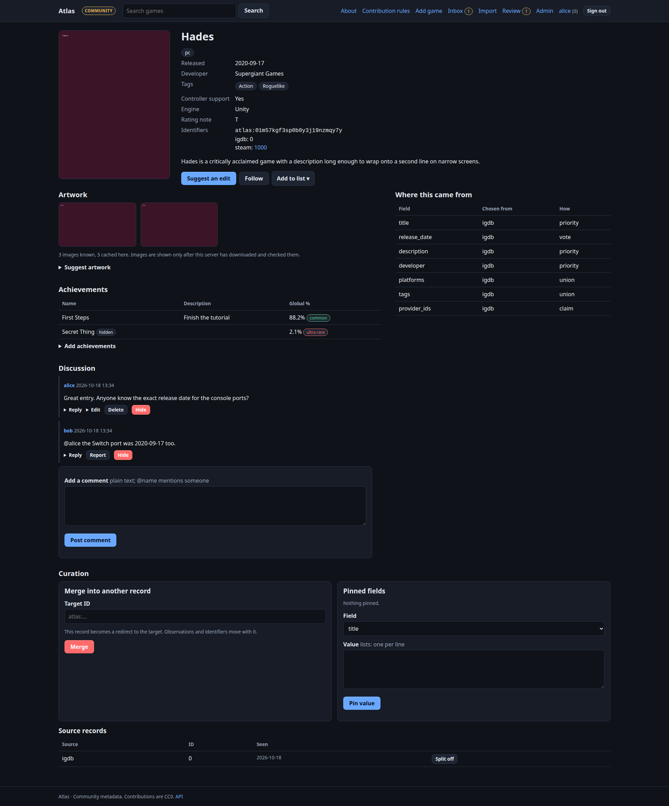

# Atlas

A semi-distributed **game metadata server**. It merges what many providers and a community say about a game into one canonical record, tells you where every field came from, and keeps working when its upstream is down. It has its own website, an API for apps (notably the [Unnamed Tracking App](https://github.com/obsoletelabs/unnamed_tracking_app_2)), and can sign people in to other software over OpenID Connect.



**→ Read the [guide](docs/guide/index.md).** Quick links: [Quick start](docs/guide/quickstart.md) · [Concepts](docs/guide/concepts.md) · [Administering](docs/guide/administering.md) · [Federation](docs/guide/federation.md) · [Sign-in sharing (OIDC)](docs/guide/sso.md) · [Tracking App](docs/guide/tracking-app.md) · [API](docs/guide/reference-api.md) · [Security](docs/guide/security.md)

## What it does

* **Merged records with provenance.** Observations from Steam, IGDB, RAWG, curators and the community are merged per field by trust; every value can be explained, pinned, split or reverted. Matching is conservative: uncertain matches become a reviewable duplicate, never a silent merge.
* **A website** to browse, contribute (reputation-gated proposals with review), discuss, keep lists and follow games, with public profiles and data export/deletion.
* **Admin-configurable without code:** name, colours, logo, menus, Markdown pages, extra typed fields per media type, limits, email, who may sign in how, peers.
* **Distributed:** one program as `authority`, `mirror` or `local` node; a signed change feed; pinned trust; per-node accounts; OpenID Connect between nodes.
* **Artwork and achievements:** downloaded only after safety checks and served from the node; achievement *lists* (never anyone's progress).
* **Email:** verification and password reset, with SMTP delivery or a readable outbox.

## Run it

```sh
cp .env.example .env     # set ATLAS_INITIAL_ADMIN and a bootstrap token
docker compose up -d     # http://127.0.0.1:8000
```

Public authority with PostgreSQL: `docker compose -f compose.authority.yaml up -d` behind a TLS proxy ([Deployment](docs/guide/deployment.md)). Without Docker: `pip install .` → `atlas migrate` → `atlas serve`.

## Status

Tested: merge/resolution, signed replication, API/auth/sessions, rate limits, migrations (including every revision and PostgreSQL), concurrent PostgreSQL writes, HTML forms/CSRF/permissions/escaping/headers, email, custom fields, social features, peers and OIDC. Release drills exercise four live HTTP nodes, two independent authorities, signed relays, key rotation and ordinary-user workflows. The signed Atlas plugin also installs and runs inside a real Tracking App/runtime stack, including search, enrichment, refresh, manual-field protection and offline behavior. See the dated [verification evidence](docs/guide/release-verification.md).

Two-factor sign-in includes encrypted TOTP secrets, recovery codes and optional reviewer/admin enforcement. Node signing keys can rotate through signed successor proofs without changing the pinned root. Mirrors retain original signed feeds for downstream relays and can build an offline recovery candidate under a fresh identity. Opt-in JSON logs and scoped Prometheus metrics support operations. See [Security](docs/guide/security.md), [Recovery](docs/guide/recovery.md) and [Release verification](docs/guide/release-verification.md).

**Not verified:** live RAWG/IGDB calls (adapters use recorded response shapes; Steam was checked live), real Proxmox LXC deployment and production load/TLS/fencing. The Tracking App drill uses isolated containers with the documented development runtime fallback; it does not establish production sandbox isolation or public artwork delivery. New UI still needs visual review. Functional drills are not availability or recovery-time guarantees. OIDC signing-key rotation and automatic authority failover remain outside the implementation.

Code: MIT. Contributed metadata: CC0 ([DATA-LICENSE.md](DATA-LICENSE.md)). The earlier demo lives in `legacy/` (`atlas import-legacy` migrates its data).
