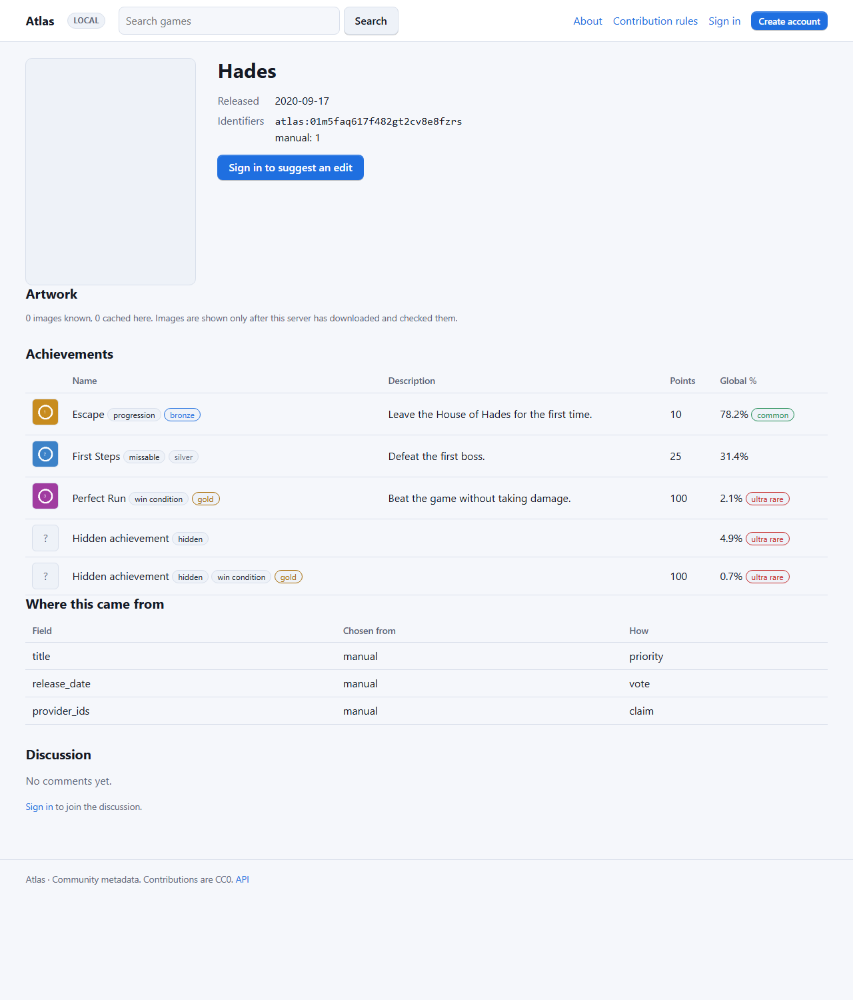
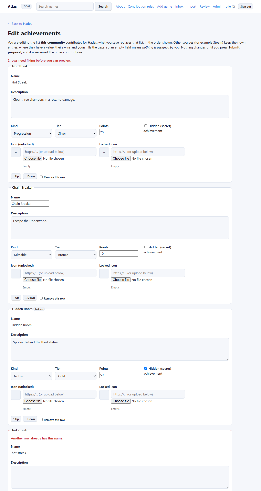
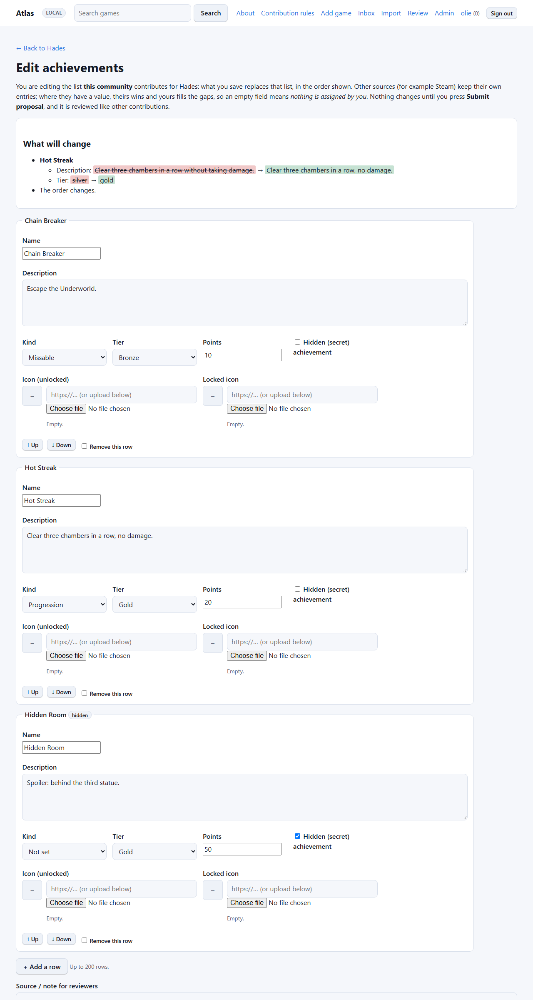

# Achievements

Atlas keeps the **list** of achievements for a game: what exists, how rare it is, what it looks like. It never stores anyone's progress; the Tracking App (or any client) keeps who unlocked what and matches it to this list using the ids below.

## What an achievement has

| Field | Meaning |
|---|---|
| `id` | Atlas id of the entry. Stable while the entry exists. |
| `name`, `description` | Text. Up to 200 / 2000 characters. |
| `hidden` | A secret achievement. See [Hidden achievements](#hidden-achievements). |
| `kind` | `progression`, `missable` or `win_condition`; absent when unknown. |
| `tier` | `bronze`, `silver`, `gold`; absent when the source has none. |
| `points` | Whole number 0–100000 (Steam has none, RetroAchievements and Xbox use them). |
| `global_percent` | Share of all players who have it, 0–100. |
| `icon_url`, `locked_icon_url` | Atlas's own verified copy of the unlocked / locked image (`/api/v2/media/<sha256>`), or `null` while it is not cached yet. |
| `external_ids` | The achievement's id at each source, for example `{"steam": "ACH_WIN_1"}`. Clients use this to match their own unlock data. |
| `sources` | Which sources contributed. |

Achievements from different sources are merged by normalised name. The highest-trust source wins each field; lower ones only fill gaps. A provider id is never assumed to match another provider's achievement with a different name.

## On the website

The game page lists achievements with icon, kind, tier, points and global percentage, in the order editors gave them (then by rarity). Hidden ones are concealed: signed-out visitors see "Hidden achievement" and a *Sign in to reveal* link; signed-in members see a **Reveal (spoiler)** button that fetches the real name and description only when they click it.



### The editor



Signed-in members use **Edit achievements** on the game page. Each achievement is a row with separate fields: name, description, kind and tier (selects), points, a *hidden* checkbox, and an unlocked and a locked icon (paste an address **or** upload a file; stored icons show a preview, addresses that are not downloaded yet say so and are never shown from the other site). Rows can be added, removed and moved up or down (without JavaScript: use *Add a row* and the *Remove this row* checkbox; reordering needs JavaScript).

* **What is assigned and what is empty.** The editor edits the list *this community* contributes. Other sources (for example Steam) keep their own entries, and where they have a value theirs wins; yours only fills gaps. So an empty field means nothing is assigned by you, and where another source already provides a value the empty select or box says so ("from steam: gold"). Entries from other sources are listed read-only below the editor.
* **Checks per row.** Each row reports its own problems (missing name, points that are not a number, bad addresses, images that are not images, duplicate names) and the page cannot be previewed until they are fixed.
* **Preview before proposing.** *Preview changes* shows exactly what will be added, removed, changed (field by field, old and new) and whether the order changes. Only then does *Submit proposal* appear. Saving **replaces** the community list with the rows shown (removals included); it goes through the normal review, can be reverted, and is applied at once for reviewers and trusted members.


* **Bulk import.** The old one-per-line format (`Name | Description | extras`; extras in any order: `progression` / `missable` / `win condition`, `bronze` / `silver` / `gold`, a number, `hidden`, icon addresses) is still available under *Bulk import* in the editor. It only **adds** entries.

## Reading

`GET /api/v2/games/{id}/achievements` (scope `read`):

```json
{
  "id": "01J…", "redirected_from": null, "hidden_count": 1,
  "results": [
    {"id": "01J…", "key": "ak1:…", "keys": ["ak1:…"], "key_identity": "steam:ACH_ESCAPE",
     "name": "Escape", "description": "Leave the house", "hidden": false, "revealed": false,
     "kind": "progression", "tier": "gold", "points": 50, "global_percent": 3.5,
     "icon_url": "/api/v2/media/<sha256>", "locked_icon_url": null,
     "external_ids": {"steam": "ACH_ESCAPE"}, "sources": ["steam"]}
  ]
}
```

### Stable keys

Every per-source achievement row has a stored **key**, `ak1:` followed by 26 lower-case base32 characters
(30 characters in all). It is derived once, when the row is created, from the row's identity: `<source>:<external_id>`,
or `<source>~<normalised name>` when the source gives no id. After that it is kept:

* Refreshing a source updates its rows **in place**. An entry is matched by its key, then by its external id and
  name, then by its external id, then by its normalised name, so a provider renaming an achievement, a reordered list or an added or removed entry keeps
  the `id` and `key` of every entry that is still there.
* A rename in the editor keeps the key, because the editor sends the key back with each row.
* Merging two records keeps the keys (the key does not include the record id), and mirrors store the authority's keys.
  When the surviving record already has a row of the same source with the same key, the survivor's row stays; when
  it holds that key under a different source, the moving row is kept and gets its derived key instead.

In the response, `keys` lists the keys of every source row merged into the entry (sorted) and `key` is the smallest
of them. `key` does not depend on this node's source-trust settings, so every node names the entry alike; it changes
only when a source adds or drops a row with a smaller key. `id` is the row id of the most trusted source: it is
stable on this node now, but it is kept for older clients only and is **deprecated as an identity**. A client that
forwards entries to another system should use `key`. `key_identity` is the plain identity behind `key`, for
debugging; it is `null` while the entry is hidden and redacted. It is not a checksum: after a rename in the editor it
names the new name while `key` keeps the old one. Keys are unique within one record, not across records.

Large catalogues can be read in pages so a single response stays small: add `limit` (1–200) and `offset`, and keep
requesting with the returned `next_offset` until it is `null`. `total` and `hidden_count` always describe the whole
catalogue, and the order is stable, so pages never overlap or skip an entry. Without `limit` the whole list comes
back in one response, as before. A client that forwards a catalogue to another system, such as the Tracking App's
Atlas plugin, should page and de-duplicate by achievement `key` (or `id` on an Atlas without keys).

Relative image paths are resolved against the Atlas base URL. Origin image addresses are never returned, so clients cannot be made to hotlink a third-party site. Images need a publicly reachable Atlas for the Tracking App to download them (as for artwork).

## Hidden achievements

Hidden achievements are viewable, but only by signed-in people and only on request, so spoilers are opt-in.

* **Anonymous visitors and the public site.** They only learn that a hidden achievement exists (and its kind, tier, points and rarity, which do not spoil anything). The page never contains the name, description, icon or provider ids.
* **Signed-in members on the website.** The row is concealed; clicking **Reveal (spoiler)** requests `/game/<id>/achievements/<achievement id>` for that single entry. The request needs the member's session and is answered `Cache-Control: no-store`, so the text is not in the page source, not in shared caches and not sent to anonymous requests. (Without JavaScript the button opens a small page with the same text.)
* **The API.** A hidden achievement is returned **redacted**: `name` is `"Hidden achievement"`, `description` is empty, no icon, no `external_ids`, `revealed: false`. To reveal, add `?reveal=all` or `?reveal=<id>,<id>` (Atlas ids or keys). A hidden entry still carries `key` and `keys`: they are digests and do not spell out the name or the provider id, while `key_identity` is `null` until it is revealed. Atlas honours it only for a **signed-in user's personal token** or a token with the `curate` scope (or `admin`). Every other token (including a plain `read` token) still gets redacted rows, even if it sends `reveal`. A client should ask for the ids the user has already unlocked. Revealed rows have `revealed: true`. If *any* source marks an achievement hidden it stays hidden.

Hidden entries and keys: a redacted entry's keys are not secret. `len(keys)` shows how many sources describe the entry (even though `sources` is blanked), and a key in the name form (`<source>~<normalised name>`, used by curator and community lists without ids) is a hash of a short, guessable name, so someone can test candidate names against it offline. Keys only confirm a guess; they never reveal a name nobody guessed. This is accepted under decision H1; keep a secret out of Atlas if a confirmable guess is too much.

Privacy tradeoff: this protects against crawlers, casual visitors and spoiler-averse readers, not against a determined member. Anyone can create an account (when registration is open) and then reveal any hidden achievement, exactly as they could with a personal token; reveal requests are not rate limited separately. Atlas has no notion of who has *unlocked* an achievement (it stores no progress), so it cannot restrict reveal to people who have earned it; the client decides which ids to ask for. Sites that want stricter secrecy can close registration or keep a game's secret achievements out of Atlas.

## Contributing

* Curators: `PUT /api/v2/games/{id}/achievements` with `{"items": [...]}` replaces the curator source's list. Every field above (except `id`, `keys`, `key_identity`, `sources`, `external_ids`) can be sent; `key` may be sent to keep an entry's key through a rename (it must be an `ak1:` key; a key another source's row already holds is ignored and a new one derived); `external_id` is the id at that source; `icon_url` / `locked_icon_url` must be `http(s)` addresses and are downloaded by Atlas's artwork cache under the same safety rules (public addresses only, content-type and size checks).
* Everyone signed in: **Edit achievements** on the game page (see [the editor](#the-editor)) creates a proposal that goes through the normal review (reputation rules, revert). Proposals can *replace* the community list (`{"items": [...], "mode": "replace"}`) or add to it.

## Host app contract

The Tracking App's Atlas plugin calls `GET /api/v2/games/{id}/achievements` (default, redacted) while it handles the normal metadata operation and forwards the entries as the app's `achievements` metadata patch. Mapping:

| Atlas | App |
|---|---|
| `id` | external id of the entry |
| `icon_url` / `locked_icon_url` | icon address (resolved against the Atlas base URL, then fetched by the app's own image pipeline) |
| `global_percent` | `rarityPercent` |
| `tier` | `tierOverride` |
| `kind`, `hidden`, `revealed`, `name`, `description`, `points` | same names |
| `external_ids` | lets the app match a user's synced progress (Steam id, RetroAchievements id) to the entry |

Entries that are hidden and not revealed are stored by the app as placeholders and not shown on shared surfaces. No per-user data is sent to Atlas. A client using a plain `read` key (the Atlas plugin's default) therefore sees only placeholders for hidden achievements; a key that is a signed-in user's personal token may send `reveal=<ids>`. Entries come back in the order editors arranged them.
