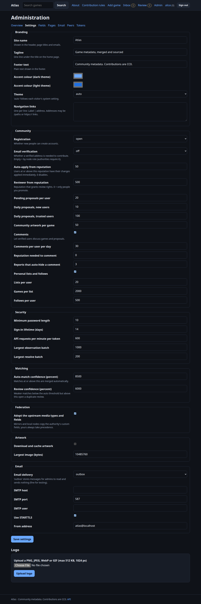
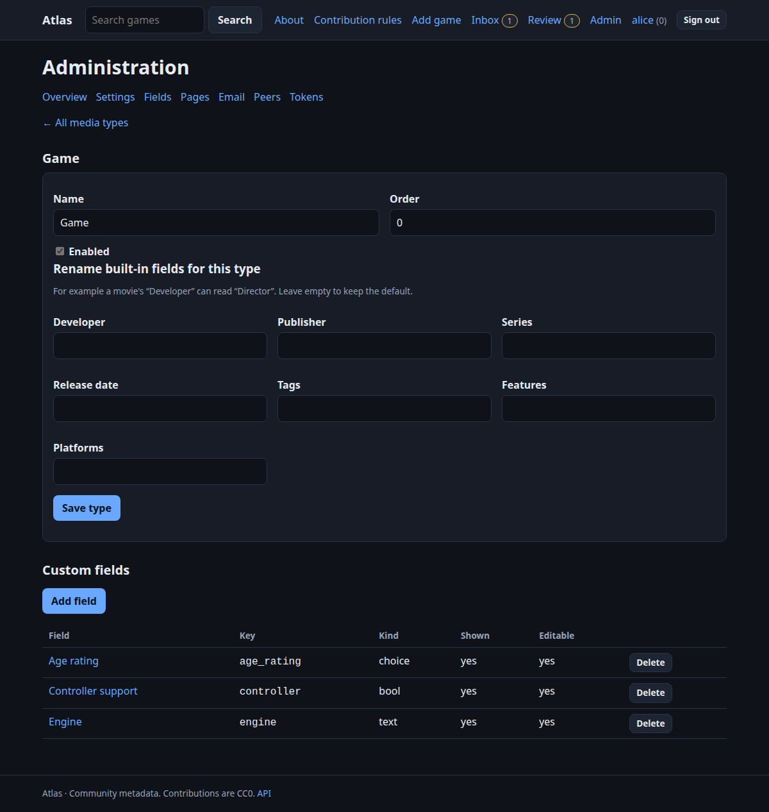
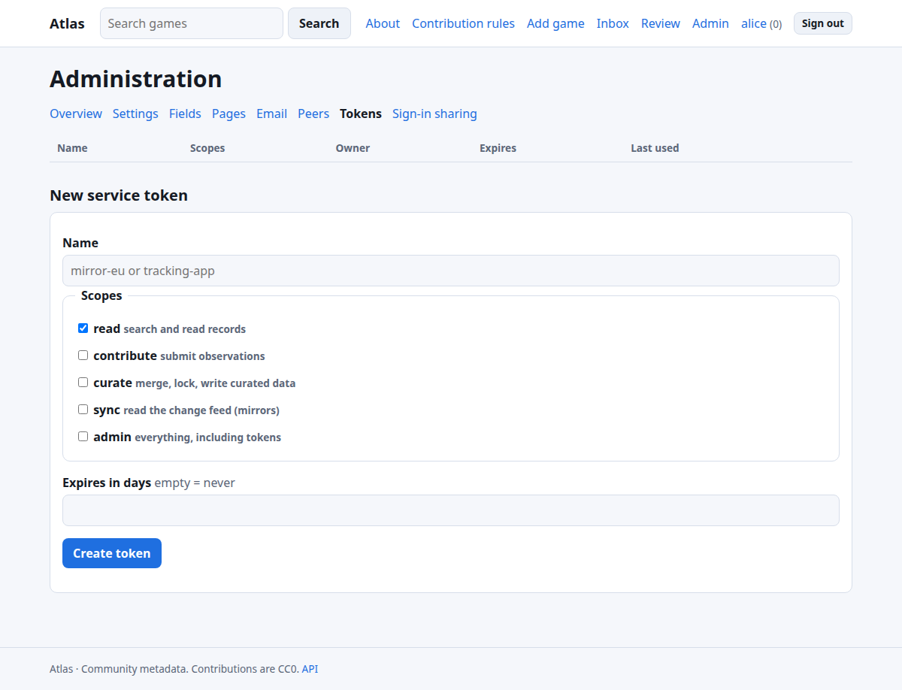

# Administering a node

Everything here is in the **Admin** area (administrators only). Almost nothing needs a restart or a code change.

## Overview

**Admin → Overview** shows the node's role and id, replication position, providers, users (role, status, email state, external sign-in permission) and a **recent activity log**: settings changed, proposals decided, roles changed, tokens created, peers added. Every moderation and admin action is recorded with who did it.

## Settings

Changes apply within seconds on every process, are validated, are recorded in the log, and can be undone with **Use default**. The full list with defaults is in [Admin settings](reference-settings.md). Groups:

* **Branding:** site name, tagline, footer, accent colours (dark/light), theme (auto/dark/light), navigation links, logo.
* **Community:** registration open/closed, email policy, reputation thresholds, proposal limits, comments and lists on/off with limits.
* **Security:** password length, sign-in lifetime, API rate limit, batch sizes.
* **Matching:** automatic-merge and review confidence.
* **Artwork:** caching on/off and size limit.
* **Email:** delivery mode, SMTP host/port/user/STARTTLS, from address.
* **Federation:** adopt upstream media types/fields; act as a sign-in provider.

Things deliberately **not** editable here (environment only): database URL, role, public URL, secret key, SMTP password, bootstrap token. See [Environment variables](reference-env.md).

### Logo and navigation

Upload a PNG/JPEG/WebP/GIF (≤512 KB, ≤1024 px; checked and re-served from the node). Navigation links are `Label | address` lines; addresses are `/paths` or `https://` only.

## Pages

**Admin → Pages** writes About, Rules, Help or anything else in **Markdown** (headings, lists, emphasis, links; raw HTML and images are ignored for safety). Pages can be drafts, ordered, and shown in the top menu. Three starter pages exist.

## Media types and custom fields

**Admin → Fields.** A **media type** says what a record is (`game` is built in; add *movie*, *anime*, *tool*…). For each type you can:

* **rename core fields**, so a movie's *Developer* reads *Director* and *Publisher* reads *Studio*;
* add **custom fields**: text, long text, number, date, yes/no, choice (with options), list, link (`https://`). Each has a label, help text, order, **shown** (page and API) and **editable by contributors** switches.

Custom values appear on the page, in the contributor form and the API (`custom`), are merged by source trust like core fields, can be proposed, reviewed and reverted, and move with records when merged. A field's *kind* cannot change after creation (create a new field instead). Deleting a field deletes its values. A type that has records can only be **disabled**, not deleted.

Authorities **replicate** their types and fields to mirrors and local nodes (Settings → *Adopt the upstream media types and fields*); a node's own definitions always win over an upstream one of the same name.

## Email

Set **Email → Delivery** to `smtp` and fill host, port, user and from; put the password in `ATLAS_SMTP_PASSWORD`. Messages are queued and sent by a background worker with retries and backoff, so a slow mail server never slows a page. **Admin → Email** lists every message and its state. With delivery `outbox` (the default) **nothing is sent**; the admin can read the messages, which is enough to try sign-up and password reset or to run a private node.

**Email verification policy:** `required` (default on authorities) means people confirm an address before they can contribute or comment; `optional` (default on other nodes) asks but doesn't block; `off` doesn't ask. Administrators are never blocked. **Mark confirmed** in the user list helps when mail isn't configured.

## Users

**Admin → Overview → Users:** set a role (*user*, *curator*, *admin*) and status (*active*, *suspended*). Suspending signs the person out everywhere and revokes their tokens. You cannot demote or suspend yourself. The first administrator is `ATLAS_INITIAL_ADMIN` (or the first account); `atlas make-admin <username>` promotes someone from the command line.

## Tokens

**Admin → Tokens** creates **service tokens** (for apps, mirrors, scripts) with scopes and optional expiry, shows the secret once, lists last use, and revokes. Scopes: `read`, `contribute`, `curate`, `sync` (replication), `admin`. People's own personal tokens appear here too (read-only, with their owner).

## Peers and sign-in sharing

* **Admin → Peers:** nodes this one replicates from. See [Federation](federation.md).
* **Admin → Sign-in sharing:** OpenID Connect both ways. See [Sign-in sharing](sso.md).

## Moderation

Reviewers handle proposals, duplicates and reported comments ([Reviewing](reviewing.md)). Administrators can also change anyone's role.

## Routine care

* Back up the database **and** the media volume ([Deployment](deployment.md#backups)).
* After upgrades, check **Admin → Overview** shows the feed head and no peer errors.
* Review the activity log occasionally; it is your audit trail.
