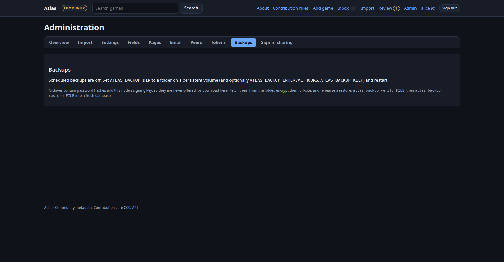

# Backup, restore and upgrades

Atlas is meant to be deployed once and left alone. That only works if you can always get your data back. This page is the
whole story: what to back up, how to restore, how to rehearse it, and how to upgrade safely.

## What a backup contains

`atlas backup create` writes **one archive** (`.tar.gz`) holding:

* every database table (accounts, records, observations, the signed change feed, settings, pages, comments, lists…),
* the cached artwork files,
* a manifest with a SHA-256 for every member, the Atlas version and the database revision.

!!! warning "Archives are secrets"
    They contain password hashes, session records and **this node's signing key**. Anyone holding the key can publish a feed
    that mirrors will accept. With `ATLAS_SECRET_KEY` set the key is stored, and archived, only encrypted (`enc:v1:`);
    without it the key is in every archive in plaintext. Files are written readable by their owner only. Encrypt them before
    they leave the machine (for example `age -p`, `gpg -c` or your backup tool's encryption) and never put one in a public
    place.

!!! danger "Keep ATLAS_SECRET_KEY apart from the archives, and never lose it"
    The archive does not contain `ATLAS_SECRET_KEY`. Store it separately (a password manager, your secrets store). A backup
    whose secret is lost **cannot restore this node's identity**: the signing key in it cannot be decrypted, and Atlas refuses
    to start rather than invent a new key. The way out is then a [mirror recovery](recovery.md) to a new trust anchor.

The archive is taken from a single consistent snapshot while Atlas keeps serving. It restores on **either** database, so it is
also how you move a local SQLite node to PostgreSQL.

## Scheduled backups (recommended)

Set a folder on a persistent volume and Atlas writes a verified archive on a schedule, keeping the newest few:

```dotenv
ATLAS_BACKUP_DIR=/backups          # mount a volume here
ATLAS_BACKUP_INTERVAL_HOURS=24     # default
ATLAS_BACKUP_KEEP=14               # default
```

In Docker add `volumes: ["./backups:/backups"]` to the `atlas` service. **Admin → Backups** lists what exists and has a
*Back up now* button. Archives are deliberately not downloadable from the website; copy the folder off the machine with your
usual tool (rsync, restic, Proxmox Backup Server, a NAS share).



Back up the folder **off the machine**. A backup on the same disk dies with the disk.

## Backing up by hand

=== "Docker"

    ```sh
    docker compose exec atlas atlas backup create /data/manual.tar.gz
    docker compose cp atlas:/data/manual.tar.gz .
    ```

=== "From source"

    ```sh
    atlas backup create manual.tar.gz        # add --no-media to leave out artwork (it can be downloaded again)
    ```

An authority running PostgreSQL can also keep using `pg_dump -Fc`; the compose stack's `backup` service does exactly that daily.
Use both if you like. A `pg_dump` restores PostgreSQL only; an Atlas archive restores anywhere.

## Check a backup (do this regularly)

```sh
atlas backup verify manual.tar.gz
```

This re-reads the whole archive and compares every checksum. A backup you have never verified is a hope, not a backup.

Add `--secret-check` to also decrypt the archive's signing key and stored credentials with this machine's `ATLAS_SECRET_KEY`
(and `ATLAS_SECRET_KEY_PREVIOUS`), without restoring anything. It fails when the secret is missing or wrong, and warns when
the archive holds a plaintext key:

```sh
atlas backup verify manual.tar.gz --secret-check
```

### Isolated restore drill

`verify` proves the archive is intact; it does not prove it restores. `drill` restores the archive into a **throwaway
SQLite database and media directory in a temporary folder** (never this node's database or `ATLAS_MEDIA_DIR`), checks
that every table loaded the number of rows the manifest lists, deletes the temporary copy, and records the time:

```sh
atlas backup drill /var/backups/atlas/atlas-20260101-020000.tar.gz
```

It needs the same `ATLAS_SECRET_KEY` as the node that made the archive (like a real restore) and enough free space in
the temporary directory for a copy of the database and artwork. With [metrics](observability.md) on,
`atlas_backup_last_restore_drill_timestamp_seconds` shows the last passing drill and
`atlas_backup_last_verified_timestamp_seconds` the last verified archive (scheduled backups are verified after they are
written). A drill is still not the full rehearsal below: it does not start Atlas, sign anyone in or migrate forward.

## Restore

Restore into a **fresh, empty** database of the same Atlas version:

1. Start with the same software version that made the backup (the manifest shows it; `atlas backup verify` prints it). Point
   `ATLAS_DATABASE_URL` at the new, empty database and set `ATLAS_MEDIA_DIR`. Set the same `ATLAS_SECRET_KEY` the backed-up
   node used.
2. Bring the schema to the backup's revision, then restore, then bring it to the latest:

    ```sh
    atlas migrate --revision <revision printed by verify>
    atlas backup restore manual.tar.gz
    atlas migrate
    ```

3. Start Atlas. Your accounts, records, tokens, settings, pages and **node identity** are back. Mirrors that follow you carry on
   from the same feed position with the same key; nobody has to re-pin anything.

With Docker, run the restore in a one-off container that mounts the folder holding the archive, for example
`docker compose run --rm -v "$PWD/backups:/restore:ro" migrate atlas backup restore /restore/manual.tar.gz`. The image runs
as uid 10001, and an archive copied out with `docker compose cp` keeps its private `0600` mode but now belongs to you. On
Linux the container then gets *Permission denied*: make the file readable first (`chmod 0644`, in a folder only you can
open) or `chown 10001` it.

**Node groups.** The group revocation journal (`ATLAS_GROUP_JOURNAL_DIR`, default `./group-journal`) is deliberately
**not** in the archive and must not live inside `ATLAS_MEDIA_DIR` or `ATLAS_BACKUP_DIR`. Keep it on the node (a persistent
volume) and do not restore it from an old copy: `restore` replays it into the restored database, so revocations, root
successions and cancellations newer than the backup are back at once, and the node stays `resyncing` until the replay and a
pull from the other members are done. `atlas backup drill` never replays it.

`restore` refuses a database that already has data. `--force` replaces it (it deletes everything first), so use it only when
you mean it. It runs in one transaction: if anything fails the database is left as it was.

!!! tip "Rehearse it"
    Once, on a spare machine or a throwaway LXC: restore your latest archive, sign in, open a few records, and confirm the
    node id (`atlas node`) matches production. That rehearsal is worth more than any amount of reading.

### The scripted drills

| Drill | What it runs | Where it runs |
|---|---|---|
| `tools/restore_drill.py` | archive create, verify, restore in-process (SQLite and PostgreSQL), encrypted key, MFA, tokens | every CI run |
| `tools/compose_restore_drill.py` | the shipped `deploy/authority/compose.yaml` with real containers: seed, `atlas backup create` + `verify --secret-check`, the `backup` service's `pg_dump`, then **`down -v`** (every volume gone), `migrate` + `atlas backup restore`, and finally `restore.sh` with the `pg_dump` file onto a drifted database | the *Compose restore drill* workflow (weekly, on demand, and on PRs touching the image, the stack or backups) |

Run the compose drill yourself against the image you deploy:

```sh
docker build -t atlas-drill:local .        # or use the image tag you run
python tools/compose_restore_drill.py --image atlas-drill:local --output compose-restore.json
```

It uses a random compose project name, leaves Caddy out (no DNS, ports or certificates), and removes every container and
volume it created, also when a check fails. After each restore it compares the node id and public key, a record, an API token,
an account password, a cached image on `/media/<sha256>`, the feed head and that the signing key is still encrypted at rest.

### Proxmox LXC (manual part)

The drill cannot create a Proxmox container from CI. On the Proxmox host, rehearse the OCI/LXC install the same way:

1. Create a throwaway LXC from the Atlas OCI image (or a Debian LXC with Docker), with **no** route to production and a new
   `ATLAS_PUBLIC_URL`, but the **same** `ATLAS_SECRET_KEY` as the node you are rehearsing.
2. Copy in the latest archive, then `atlas migrate --revision <rev>`, `atlas backup restore <archive>`, `atlas migrate`.
3. Start Atlas and check: `atlas node` prints the production node id; `atlas backup verify <archive> --secret-check` passes;
   an API token and an admin sign-in work; a record and its cover image open.
4. Record the date, the archive name, the node id and anything that failed in your operations log. Destroy the LXC
   (`pct destroy <vmid> --purge`) so a second copy of the identity never starts.

## When the node is lost entirely

* **A mirror or local node** can be rebuilt from its upstream: install, point `ATLAS_UPSTREAM_URL` at it, and it replicates the
  feed again. You lose only local-only things (local overlays, local accounts) so back those up anyway.
* **An authority** should be restored from a current verified backup. If that is unavailable, use the
  [mirror recovery runbook](recovery.md) to recover only the retained public feed under a **new root**.
  Accounts/private data still need a backup. Never run two copies of the same identity at once.
* Keep the **node signing key** safe: it is in every archive (encrypted when `ATLAS_SECRET_KEY` is set), and
  `atlas node` shows the public id you published. Keep `ATLAS_SECRET_KEY` with your recovery records, not with the archives.

## The signing key at rest

`ATLAS_SECRET_KEY` encrypts the node's Ed25519 signing key in the database (`node_state.signing_key` holds
`enc:v1:<token>`), together with peer tokens, OIDC client secrets, stored provider credentials and authenticator secrets.
**Admin → Signing keys** and `GET /api/v2/status` (`"signing_key_at_rest": "encrypted"` or `"plaintext"`) show which form
this node has.

* **Upgrading an existing node (migration 0024).** If `ATLAS_SECRET_KEY` is set when `atlas migrate` runs (the compose
  `migrate` service reads the same `.env`), the existing key is encrypted in place. Otherwise the first start with a secret
  does it and records `signing_key_encrypted` in the audit log. The key itself never changes: same node id, same key id,
  nothing for followers to re-pin.
* **Several replicas: stop every old one first.** A replica still on the release before 0024 cannot read an `enc:v1:` key.
  As soon as the key is encrypted (by `atlas migrate` with the secret, or by the first new replica that starts with
  `ATLAS_SECRET_KEY`), every old replica fails its next feed write or key load. It fails closed: it never generates a new
  key and loses no data, but every write it handles fails until it is replaced. So do not roll this upgrade one replica at
  a time: stop all replicas on the old release, run `atlas migrate` once, then start the new release everywhere.
* **Restoring an encrypted backup.** `atlas backup restore` checks that this node's `ATLAS_SECRET_KEY` (or
  `ATLAS_SECRET_KEY_PREVIOUS`) decrypts the archive's signing key before it deletes anything, and refuses otherwise.
* **No secret.** The key stays plaintext and Atlas warns on every start. **A production authority without
  `ATLAS_SECRET_KEY` will refuse to start in a future release** (after signed updates ship); this release only warns.
  Set the secret now: `atlas secret-key` prints one.
* **A missing or wrong secret** for an encrypted key stops Atlas with `signing key is encrypted; ATLAS_SECRET_KEY is missing
  or wrong`. It never generates a replacement identity.
* **Rotating the secret.** Put the new value in `ATLAS_SECRET_KEY` and the old one in `ATLAS_SECRET_KEY_PREVIOUS`
  (comma-separated for several), restart, and run `atlas secrets rewrap`. That re-encrypts the signing key and every stored
  secret with the new value. It changes nothing if any value does not decrypt. Then remove the old value. Archives made
  before the rotation still need the old secret.
* **Rolling back to a release before 0024.** Older releases cannot read an `enc:v1:` key. The supported way back is the
  one under [Upgrading](#upgrading): restore the pre-upgrade backup, which holds the key as it was then. A schema downgrade in
  place (migration 0024's downgrade, for example `alembic downgrade 0023`) decrypts the key back to plaintext when
  `ATLAS_SECRET_KEY` is set, and refuses, changing nothing, without it.

## Upgrading

Updates should be rare. When you do one:

1. `atlas backup create` and `atlas backup verify` first. Copy it off the machine.
2. Pin versions. Use a version tag (for example `ghcr.io/obsoletelabs/unnamed_tracking_metadata:2.0.0`), never `latest`, in
   production.
3. On an authority run migrations explicitly (`docker compose run --rm migrate`, or `atlas migrate`), then restart. The compose
   file already does this in the `migrate` service and keeps `ATLAS_AUTO_MIGRATE=false` on the app.
4. Migrations only go forward. To go back you restore the pre-upgrade backup into a database at the old version, which is why
   step 1 matters.
5. Upgrade followers/relays before activating a new signing key or other incompatible feed behavior.
   Confirm all understand successor proofs before using Admin → Signing keys.

## Reserved custom-field names

Migration `0014` preserves historical custom fields whose names became core fields:
`age_rating`, `genres`, `themes`, `languages`, `aliases`, `website`, `critic_score`, `user_score`.
They become `custom_<old>` with `_2`, `_3`, … when necessary. Field IDs, labels, values,
source/redistribution flags, timestamps, proposal payloads and revert history are preserved.
Original signed feed bodies and signatures are never rewritten. Historical snapshots are
translated when replayed. Admin → Fields shows the exact mapping and an audit entry records it.

Old custom input names remain aliases, but output uses the new names; update clients that read
`custom.genres` (for example) to the name shown in the warning. Sending both old/new names in
one request is rejected, including when one is empty. Core fields remain separate. The rename
is deliberately not reversed on downgrade, since clients may already use the new key.

Keep `ATLAS_SECRET_KEY` with the backup configuration: it decrypts the node signing key, MFA, peer tokens and
OIDC client secrets. The archive contains encrypted values, not that external encryption key.
Use [Release verification](release-verification.md) to rehearse full-table and artwork restore
with both SQLite and PostgreSQL before an upgrade.
