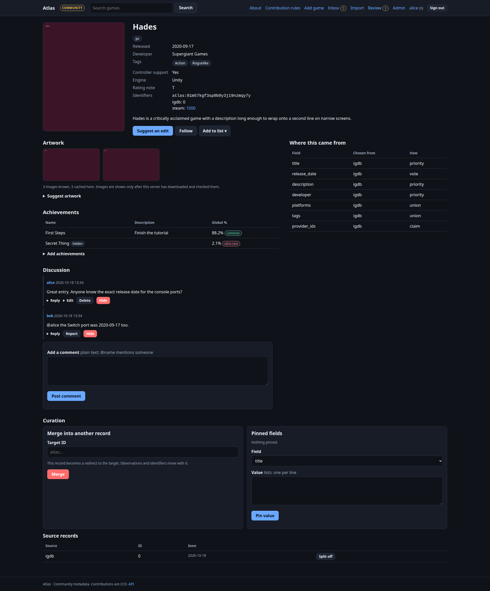

# Atlas guide

Atlas is a **game metadata server**. It gathers what many providers (Steam, IGDB, RAWG…) and a community say about a game, merges it into **one canonical record**, and keeps track of **where every detail came from**. Other programs, above all the [Unnamed Tracking App](tracking-app.md), read that record through an API. People browse and improve it on Atlas's own website.

It is designed to be run by many people:

* a **central authority** that a community curates,
* **mirrors** that copy it for speed and resilience,
* **local nodes** that cache providers for one household and can still follow a central node.

Everything an operator normally wants to change (name, colours, logo, menus, pages, extra fields, limits, email, who may sign in how) is a setting in the admin UI. **You should not need to change code to run your own Atlas.**

## Where to start

| I want to… | Read |
| --- | --- |
| try it in five minutes | [Quick start](quickstart.md) |
| understand how records are built | [Concepts](concepts.md) |
| use or contribute to a site | [Using the site](using-the-site.md) |
| review other people's changes | [Reviewing](reviewing.md) |
| run and configure a node | [Administering](administering.md), [Deployment](deployment.md) |
| run several nodes | [Federation](federation.md), [Sign-in sharing](sso.md) |
| connect the Tracking App | [Tracking App](tracking-app.md) |
| call the API | [API reference](reference-api.md) |
| look up a setting | [Environment variables](reference-env.md), [Admin settings](reference-settings.md) |
| understand the safety model | [Security](security.md) |
| add providers or fields | [Extending](extending.md) |
| fix a problem | [Troubleshooting](troubleshooting.md) |

## What it is not

* **Not a tracker.** Atlas holds facts about games. Playtime, ownership and completion belong to the app that tracks them. Atlas deliberately discards personal facts it is sent.
* **Not a store of provider data to redistribute.** Provider-derived data stays on the node that fetched it. Only what people contribute (released as CC0) is replicated.

Contributed metadata is dedicated to the public domain under [CC0 1.0](../../DATA-LICENSE.md); the software is MIT.
