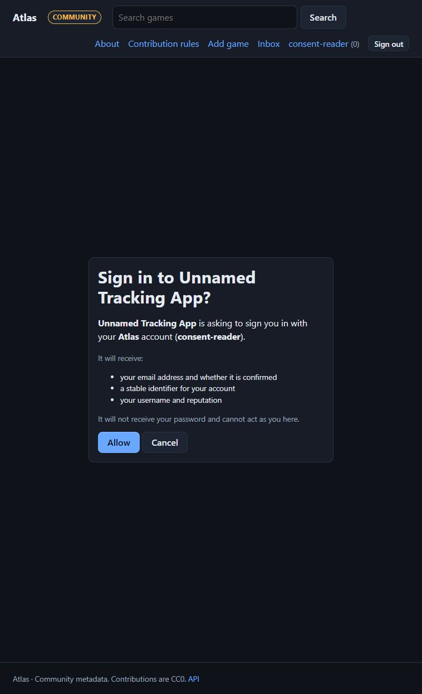
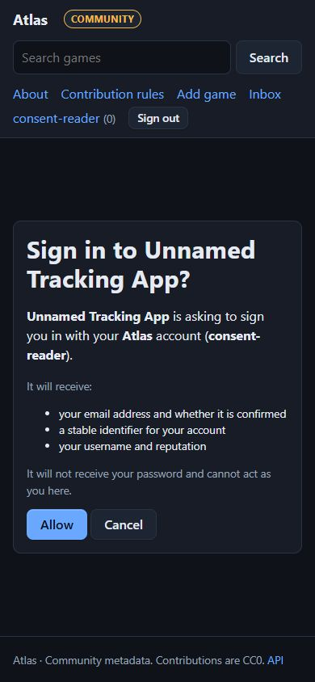
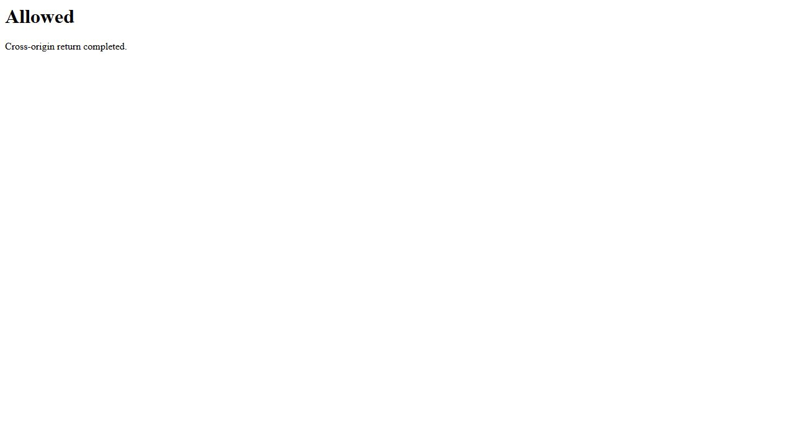

# Release verification

The tools run **their own disposable nodes and databases**, without provider keys or deployed
production services. Reports contain checks and public node IDs, never passwords, tokens,
recovery codes or private signing keys.

## Repeatable commands

From a source checkout with locked development dependencies:

The checkout pins development and CI to Python 3.12 in `.python-version`, matching
the Docker runtime. Keep that pin when running the locked development dependencies:
the optional embedded PostgreSQL test helper currently provides a CPython 3.12
wheel only. A newer Python preinstalled on a CI runner must not silently select a
different test interpreter. The PostgreSQL service and all existing test/drill
checks remain enabled.

The dependency floor includes Pillow 13.0 for its image-decoder security fixes and
certifi 2026.10.19 for the updated CA bundle. Keep the committed lockfile when
building the release, and run the dependency audit without suppressing advisories:

```sh
uv export --frozen --no-dev --no-emit-project -o /tmp/atlas-requirements.txt
uvx pip-audit -r /tmp/atlas-requirements.txt --no-deps --disable-pip
```

See the [Pillow security release notes](https://pillow.readthedocs.io/en/stable/releasenotes/13.0.0.html)
and [certifi release](https://github.com/certifi/python-certifi/releases/tag/2026.10.19).

```sh
uv sync --frozen --extra dev
uv run ruff check atlas tests tools
uv run pytest -q
uv run python -m tools.multinode_drill --output topology-sqlite.json
uv run python -m tools.restore_drill --output restore-sqlite.json
```

For real PostgreSQL, supply a **disposable development cluster** administrator URL:

```sh
uv run python -m tools.multinode_drill \
  --postgres-admin-url "$ATLAS_TEST_PG_URL" --output topology-postgres.json
uv run python -m tools.restore_drill \
  --postgres-admin-url "$ATLAS_TEST_PG_URL" --output restore-postgres.json
```

The tools create random `atlas_drill_*` databases and drop exactly those afterwards, including
on failure. They do not clear the database named in the URL. The account needs create/drop
database permissions. **Do not use production credentials.** Servers use ephemeral loopback
ports. Temporary SQLite/media folders and subprocesses are removed on exit. JSON success
reports are written only after every assertion passes.

## Version skew drill

`python -m tools.skew_drill --output skew-1.0.json` runs the previous release next to this one as real
HTTP servers. It unpacks `--previous-ref` (default: the pinned commit `62c73f3`, the last v2 release before protocol
negotiation; a branch would move once this release is merged) with `git archive`, so the repository is
not changed, and installs it into its own virtual environment with `uv sync --frozen`. Every node uses a
disposable folder, SQLite and synthetic data on loopback. It checks that:

* a previous-release (1.0) follower converges on an authority of this release emitting protocol 1.0, and
  the authority records that follower as 1.0 (what keeps `emit_protocol` from being raised);
* a follower of this release accepts a previous-release authority and reports `in_sync` only after it
  verified and applied the advertised head;
* entries the previous release skipped silently (an unknown kind, an observation with an `ext` member)
  are recovered when that follower is upgraded in place: `atlas sync replay --rescan` records them,
  a plain `atlas sync replay` applies nothing below the cursor (never out of order), `atlas sync replay
  --historical` re-applies the retained range in feed order so the observation is applied, and the
  unknown kind stays parked with its reason.

The Federation lab workflow runs it after the scenarios and uploads `skew-1.0.json`. See
[Compatibility and upgrades](federation.md#compatibility-and-upgrades).

## Topology and ordinary users

The topology starts four real HTTP servers: two authorities → mirror → local node. The
PostgreSQL variant uses PostgreSQL for both authorities and SQLite for followers. It tests:

* identities, liveness/readiness and independent origin pins;
* both catalogues/custom schemas downstream, original signatures, relay feed selection and
  repeated sync without duplication;
* signing-key rotation after initial sync without changing the root pin;
* ordinary-user browse, profile, export and read-only personal API tokens;
* private-list create/add/remove/delete, ownership denial, follow/unfollow, escaped comments,
  owner-only edits, reporting, moderator denial, pending proposals, approval and notifications;
* administrator/reviewer denial, CSRF rejection, read-token write denial and cross-node
  cookie/token rejection;
* accounts, sessions and private profile information staying local;
* one authority's outage/restart while the other updates and cached relay reads continue;
* protected metrics and account deletion revoking credentials while games remain.

Comment redirects must place success queries before fragment anchors; the live drill caught
and now covers this regression. Approved public metadata reaches followers, while list notes,
profile data, comments and private proposal notes stay outside the signed feed.

Regressions also cover malformed signatures, ambiguous/unpinned relays, history rewind,
retired keys, concurrent replay and MFA recovery-code consumption. Schema snapshots belong
to their origin, so one cannot delete another's definitions. Independent authorities still
need agreed namespaces and conflict policy; this is not a multi-writer consensus test.

## Restore and recovery

The restore tool creates metadata, synthetic cached artwork, account/password/token, encrypted
MFA and a rotated signing key. It creates/verifies an archive, restores an empty database,
compares **every table** checksum and exact image bytes, verifies password/token authentication,
decrypts MFA and validates signing history/feed. A second restore must refuse occupied storage
without changing it.

`tests/test_promotion.py` reconstructs a candidate from one mirror origin, verifies its fresh
root/feed, excludes local/private/other-authority data, checks source immutability, and refuses
gaps, tampering, unknown kinds, wrong source/role and existing output. See [Recovery](recovery.md).

## Evidence limits

Loopback drills use development HTTP. They do not verify production TLS/proxy headers, SMTP
delivery, public OIDC-provider setup, live RAWG/IGDB quotas, real network partitions,
multi-process load or a Proxmox host. Run the tools in a throwaway LXC to test its actual
storage/runtime; workstation success is **not** an LXC deployment claim. No RPO/RTO target
is established by these functional drills.

Record commit, date, database versions, commands and sanitized reports per release. Keep UI
screenshots with the review. Live-provider checks remain separate; the operator-run package
acceptance below covers installation in the Tracking App.

## Tracking App package acceptance

Provision a fresh disposable Tracking App backend, PostgreSQL and plugin runtime, plus an
Atlas node reachable both by this tool and by the runtime. Start the host with a synthetic
administrator. No host or plugin source is imported by this tool, and the original signed
package is not modified. Set `TRACKING_APP_TEST_PASSWORD` and `ATLAS_TEST_ADMIN_TOKEN` through
private environment configuration, then run:

```sh
uv run python -m tools.tracking_app_drill --disposable \
  --host-url http://127.0.0.1:18764 --username atlas-host-admin \
  --atlas-url http://127.0.0.1:18767 --atlas-peer-url http://atlas:8000 \
  --package /path/to/official.metadata-atlas-0.2.0.utp \
  --output tracking-app.json
```

The command requires an empty plugin inventory and explicit `--disposable` confirmation. It
creates a user/game, installs a package, changes provider configuration and leaves that test
state for inspection. Remove **only your own stack and volumes** afterwards. Never point it
at an existing deployment. Production credentials are neither needed nor appropriate.

The check exercises a real signed installation/worker, ordinary-user configuration inheritance
and secret redaction, search/enrichment/selection, session ownership, library refresh, manual
field locks and failure while Atlas is unreachable. It does not verify browser layout,
production sandboxing, public artwork delivery or achievements. The package SHA-256 and public
publisher key ID appear in the report. This cross-repository drill is operator-run; the four-node
and restore drills run in CI without needing the Tracking App checkout.

## 19 October 2026 acceptance evidence

Run in isolated Ubuntu 24.04 WSL test instances. The public reports record the source commit;
the evidence commit only adds documentation. No existing deployment was used or changed.

| Check | Evidence | Result |
| --- | --- | --- |
| Two SQLite authorities → mirror → local, including regular-user workflows | [Topology](verification/2026-10-19/topology-sqlite.json) | Passed |
| Two PostgreSQL 16.15 authorities → SQLite mirror → local | [Topology](verification/2026-10-19/topology-postgres.json) | Passed |
| SQLite full-table, MFA, rotated-key and image restore | [Restore](verification/2026-10-19/restore-sqlite.json) | Passed |
| PostgreSQL 16.15 equivalent restore | [Restore](verification/2026-10-19/restore-postgres.json) | Passed |
| Published signed Atlas package in Tracking App/runtime with PostgreSQL 18.6 | [Package acceptance](verification/2026-10-19/tracking-app.json) | Passed |

The package check used host commit `5e0f61438e6905b51495b5c505ab925cb71ec6bb` and plugins commit
`c0b3be0cd33258d97472242d09fa603507200e03`, with the unchanged signed 0.2.0 package. The host
was rebuilt from source into its own disposable stack. Package digest, archive SHA-256 and
publisher key ID are in the report. A fresh stack repeated the successful run after harness
corrections; failed harness assertions were not accepted as passes.

Additional regressions exercised eight concurrent first starts on PostgreSQL, both an empty
database and legacy identity metadata; eight attempts to consume one recovery code; and
rotation alongside nine writers with cached heads. The first-start test reproduced a duplicate
signing-key insertion before the fix. Comment-anchor regression tests likewise followed a live
failure reproduction. Ruff, generated-reference checking, strict MkDocs and a non-root container
build/liveness/readiness smoke check passed.

## Container base image

The `Dockerfile` names `python:3.12-slim` by its multi-arch index digest in both stages, so a
rebuild of the same commit starts from the same bytes. Dependabot's `docker` ecosystem proposes
a new digest when Docker publishes one; review it like any dependency bump. The runtime stage
also runs `apt-get upgrade`, because Debian publishes security fixes before the official image
is rebuilt: on 8 November 2026 the newest `python:3.12-slim` still carried zlib1g
`1:1.3.dfsg+really1.3.1-1+b1` (CVE-2026-76844, CVE-2026-85091, HIGH), which the publish job's
Trivy scan rejects, while trixie-security already had `+deb13u1`.

The publish job keeps a BuildKit layer cache, and with the base pinned by digest the
`apt-get upgrade` instruction would otherwise hit that cache on every rebuild. The workflow
therefore passes `no-cache-filters: runtime` to `docker/build-push-action`, so the runtime stage
(and its upgrade) is rebuilt every time while the dependency-install stage stays cached. When
Debian ships a fix for a finding that Trivy currently reports as unfixed, re-running the publish
job picks it up; no Dockerfile change is needed. The scan resolves the multi-arch digest to its
`linux/amd64` image; the arm64 image is built from the same stages.

To check an image locally with the Trivy version CI uses (trivy-action v0.36.0 runs Trivy 0.70.0):

```sh
docker build -t atlas:check .
docker run --rm -v /var/run/docker.sock:/var/run/docker.sock aquasec/trivy:0.70.0 \
  image --severity HIGH,CRITICAL --ignore-unfixed --exit-code 1 atlas:check
```

## 21 October 2026 security-update verification

Source commit `56f3bc2fdf33aa4812a1cb95d437d3a63791e381` passed **425 tests** locally
against isolated PostgreSQL, including the four supported image-format checks with
Pillow 13.0.0. The dependency audit reported no known vulnerabilities. Ruff,
generated-reference checks and strict MkDocs also passed.
[CI](https://github.com/obsoletelabs/unnamed_tracking_metadata/actions/runs/39525364807)
passed the test, topology/restore, dependency-audit and Docker smoke gates;
[documentation checks](https://github.com/obsoletelabs/unnamed_tracking_metadata/actions/runs/39525364798)
passed on the same source commit.

The real HTTP drills were repeated locally with Python 3.12.14, Pillow 13.0.0 and
certifi 2026.10.19. The reports record the exact PostgreSQL version and source:

| Check | Evidence | Result |
| --- | --- | --- |
| Two PostgreSQL authorities → SQLite mirror → local, including ordinary-user workflows and authority outage/restart | [Topology](verification/2026-10-21/topology-postgres.json) | Passed |
| PostgreSQL full-table, cached-image, encrypted-MFA and rotated-signing-key restore; occupied-target refusal | [Restore](verification/2026-10-21/restore-postgres.json) | Passed |

These runs use disposable development services. They do not extend the production
TLS, load, Proxmox or downstream image-delivery claims described above.

**Visual review is pending.** A saved browser permission policy denied the isolated origin,
including the integrated tab opened by the operator. No new UI screenshots were captured.
Review account security/enrollment/challenge, Signing keys, the custom-field rename warning
and relay selection at desktop and narrow widths before removing the PR's draft status.

## 21 October 2026 consent verification

Consent source `4665d51` passed **56 OIDC and web tests** against disposable SQLite
and PostgreSQL fixtures. The preceding consent-policy implementation passed the
full **434-test** suite; the later change adjusts only consent layout. Ruff passed.

A disposable regular member used the actual browser-rendered consent form in the
integrated Chromium browser. **Cancel** reached a separate callback origin with
`access_denied`; **Allow** reached it with an authorization code. Neither action
reported a CSP error. This verifies the native form and cross-origin return, not
a complete Tracking App token exchange or production sign-in.

| Viewport | Result |
| --- | --- |
| 1280 × 720 | Card centered between the real header and footer |
| 390 × 844 | Card centered in the available space; wrapped navigation and all actions visible |
| 1280 × 360 | Page scrolls naturally; Cancel remained reachable and completed the return |

The synthetic callback origin was `localhost:18783`, separate from the provider
at `localhost:18782`. Viewport overrides were reset and test tabs closed afterward.
No production credentials or settings were changed.






