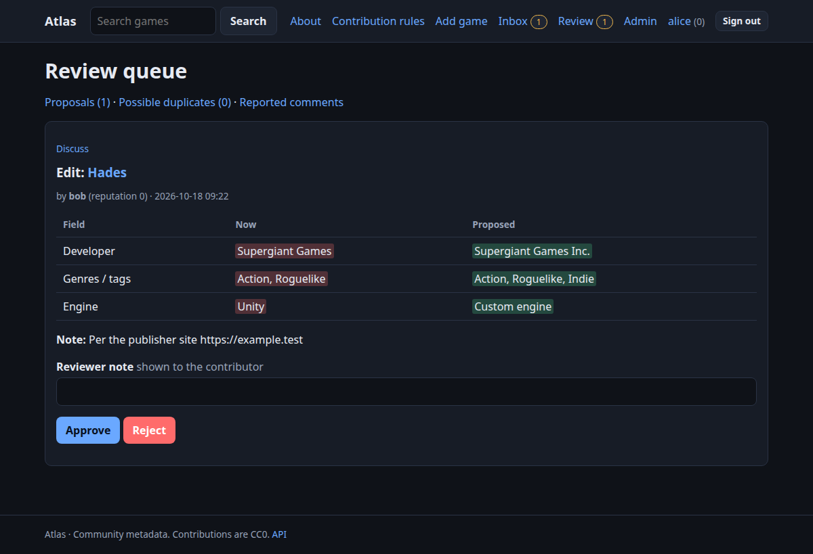

# Reviewing

You can review if an administrator made you a **curator**, or your reputation reached the node's threshold (500 by default). You cannot review your own proposals (administrators may).

## The queue

**Review** lists pending proposals oldest first, each as a diff. *Approve* applies the change and rewards the contributor; *Reject* explains why (the note is shown to them). Open a proposal's **Discuss** link to ask a question first.

Good review habits: check the cited source; approve improvements even if imperfect; reject unsupported or promotional changes; leave a short note either way.

## Possible duplicates

**Review → Possible duplicates** lists records Atlas was not sure about (`possible_duplicate`) or whose identifiers disagree (`id_conflict`), with a confidence. *Merge into this* folds the record into the other (a redirect remains); *Not duplicates* dismisses it.

## On a game page

Reviewers also see **Curation**:

* **Merge** into another record by id.
* **Pinned fields**: fix a value permanently (beats every source). Unpin later.
* **Source records**: every observation behind the record; **Split off** moves a wrongly merged source record onto its own game.
* **Revert a change**: undo an approved community change. Reverts go newest first, because each restores the state before that change.

## Comments

**Review → Reported comments** shows reported and auto-hidden comments. *Hide* removes it from view (the author loses 3 reputation); *Keep visible* dismisses the reports.

## Things that cannot happen by accident

* Reviews, reverts and withdrawals are serialised, so two reviewers never apply or pay for the same proposal twice.
* Everything you do is in the audit log (**Admin → Overview**).
