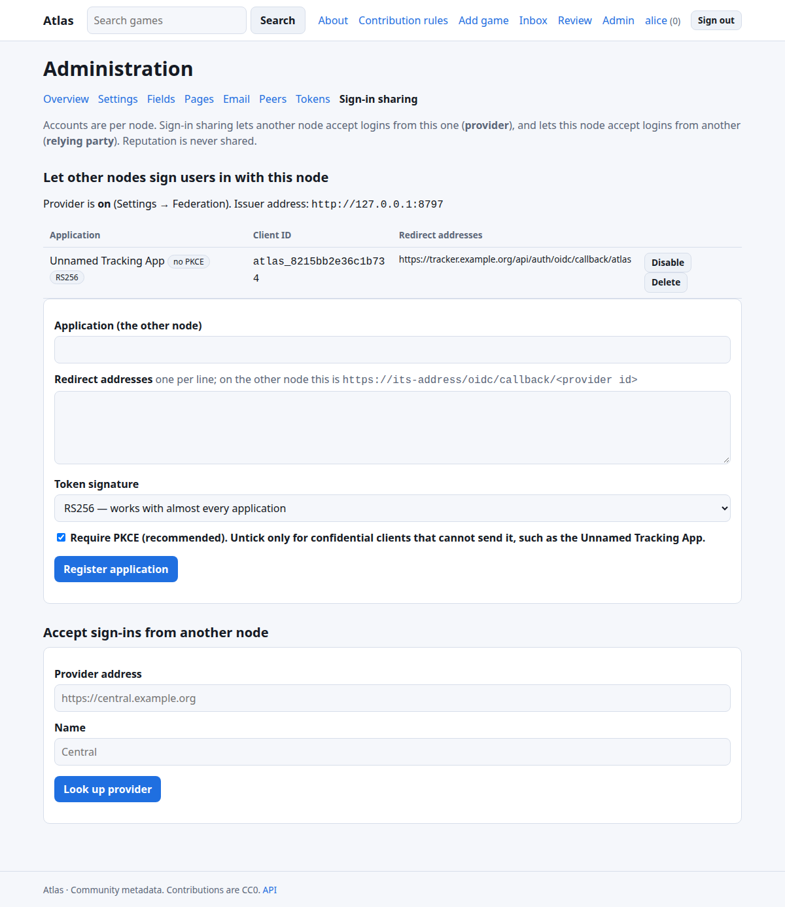
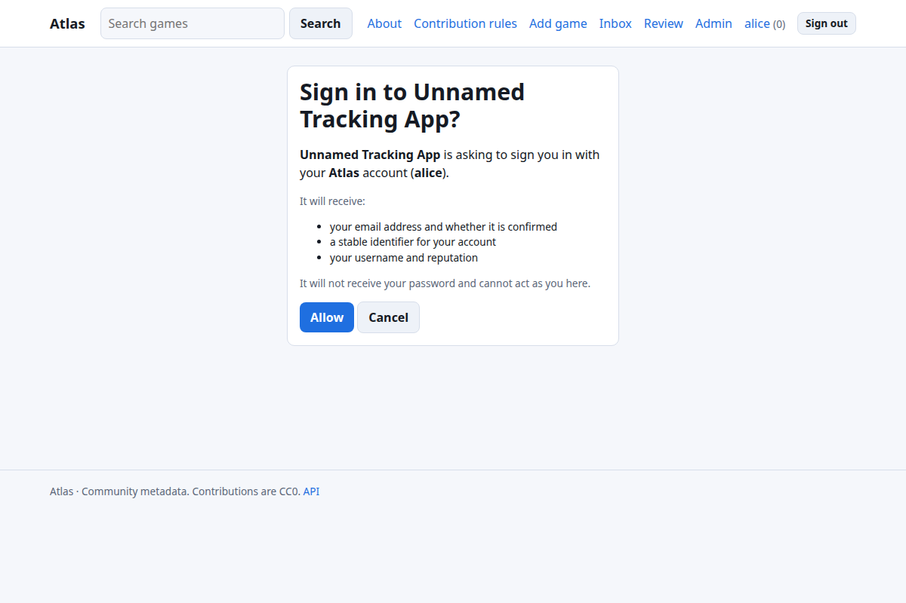

# Sign-in sharing (OpenID Connect)

Atlas can be an **OpenID Connect provider**: people who have an account on an Atlas node can use it to sign in to other software. Atlas can also **accept** sign-ins from another Atlas node. Accounts and reputation always stay per node.

> Using this with the Unnamed Tracking App? Jump to [Signing in to the Tracking App with Atlas](tracking-app.md#signing-in-to-the-tracking-app-with-atlas).

## What Atlas offers

| | |
| --- | --- |
| Flow | Authorization Code (with a consent screen) |
| Discovery | `https://<node>/.well-known/openid-configuration` |
| Endpoints | `/oidc/authorize`, `/oidc/token`, `/oidc/userinfo`, `/oidc/jwks` |
| Scopes | `openid` (required), `profile`, `email` |
| Client authentication | `client_secret_basic` or `client_secret_post` |
| PKCE | `S256`; required by default, can be waived per confidential client |
| ID token signature | **RS256** (default, works with almost everything) or **EdDSA** (for other Atlas nodes); both keys are in the JWKS |
| Lifetimes | authorization code 5 min (single use), ID token 10 min, access token 1 h |
| Claims | `sub` (stable account id), `preferred_username`, `email`, `email_verified`, `atlas_reputation` |

Not offered: refresh tokens, dynamic client registration, RP-initiated or back-channel logout, group/role claims. Atlas never exports its roles: they are meaningful only on the node that granted them.

## 1. Turn the provider on

**Admin → Settings → Federation → Act as a sign-in provider (OIDC)**. Set `ATLAS_PUBLIC_URL` to the exact address people use (it **is** the issuer, and must be `https://` in production). Check <https://your-node/.well-known/openid-configuration> answers.

## 2. Register the application

**Admin → Sign-in sharing → Register application**

* **Name:** shown on the consent screen.
* **Redirect addresses:** one per line, matched **exactly**. `https://…` or `http://localhost…` for testing. The application tells you its address (often `https://app.example.org/…/callback`).
* **Token signature:** leave **RS256** unless the application is another Atlas node.
* **Require PKCE:** leave ticked if the application sends PKCE. Untick for confidential clients that cannot (the Tracking App's Authlib client is one).



You are shown a **client id** and **client secret** once. Atlas stores only a hash of the secret; if it is lost, delete the application and register it again.

## 3. Configure the application

Give it the **issuer / discovery URL** (`https://your-node`), the client id and secret, and scopes `openid profile email`. Almost every OIDC-capable application then needs nothing else, because it reads the discovery document.

If it asks for endpoints individually, use the ones in the table above. If it wants to **map claims**: username ← `preferred_username`, email ← `email`, unique id ← `sub`.

**Match users by `sub` where you can.** Usernames can change; `sub` cannot. Do not trust `email_verified: false` for account linking: Atlas sets it to `true` only for addresses the person has confirmed.

### Quick check with a few lines of Python

```python
# pip install authlib httpx
from authlib.integrations.requests_client import OAuth2Session
import requests
disc = requests.get("https://your-node/.well-known/openid-configuration").json()
print(disc["issuer"], disc["id_token_signing_alg_values_supported"])
```

Atlas's repository contains a complete end-to-end check that drives the real Authlib client stack used by the Tracking App through a login against a live node: `tools/compat/tracking_app_oidc.py`.

People then see a consent screen the first time each sign-in happens:



## Accepting sign-ins from another Atlas node

On the node that should *accept* sign-ins (for example a household node signing in with the central one):

1. On your node: **Admin → Sign-in sharing → Accept sign-ins from another node → Look up provider.** Atlas fetches its discovery and keys and shows the provider's **node id fingerprint**. **Compare it with what the provider's administrator gave you.** Atlas pins that key and will only accept ID tokens signed by it (the algorithm is never negotiated). The page also shows the exact **redirect address** to register.
2. On the **provider** node, register an application as above with that redirect address and signature **EdDSA**; copy the client id and secret.
3. Back on your node, enter the client id and secret (stored encrypted; needs `ATLAS_SECRET_KEY`) and choose:
   * **Every user here may link and use it** (otherwise you enable it per user in the user list),
   * **Create an account on first sign-in**,
   * **Trust the provider's confirmed email address**.
4. The sign-in page now shows a button for the provider.

How accounts are connected:

* A person with an existing local account **links** it from **Profile settings → Linked sign-ins** (needs permission, above). Email addresses are **never** used to take over an existing account; if auto-create is on and the username is taken, a new account with a suffix is made.
* Accounts created this way have no password. They can add one with *Forgot password* if they have an email, and cannot unlink their only way in.

## Troubleshooting

| Symptom | Cause |
| --- | --- |
| “unknown application or redirect address” | The redirect in the request is not **exactly** one registered (check scheme, port, trailing slash). |
| “PKCE with S256 is required” | The client does not send PKCE; untick *Require PKCE* for that application. |
| “issuer mismatch” / discovery fails in the app | `ATLAS_PUBLIC_URL` differs from the address the app uses; they must match exactly. |
| App says the email is missing | The Atlas user has no email address; add one (and on central nodes confirm it). |
| `invalid_client` | Wrong secret, application disabled, or credentials sent in an unsupported way. |
| `invalid_grant` | Code reused, expired (5 min), redirect changed between steps, or PKCE verifier wrong. A reused code also revokes its tokens. |
| Provider button missing on your node | Provider disabled, or `Accept sign-ins` entry is switched off. |
| “External sign-in is not enabled for this account” | Allow the user (user list) or tick *Every user…* on the provider. |

## Security notes

* Redirect addresses are exact-match, and an error for an unregistered address is shown on Atlas, never redirected to an unvetted site.
* A person must **consent** each time. The consent screen names the application and what it receives.
* Codes are single use and are burned by any attempt; replaying one revokes the tokens it produced.
* ID tokens from other Atlas nodes are verified against the key you pinned, with issuer, audience, nonce, expiry and issued-at checks; `alg: none` and algorithm-confusion attempts are rejected (all tested).
* Rotating the RSA signing key is not yet a one-click action.
