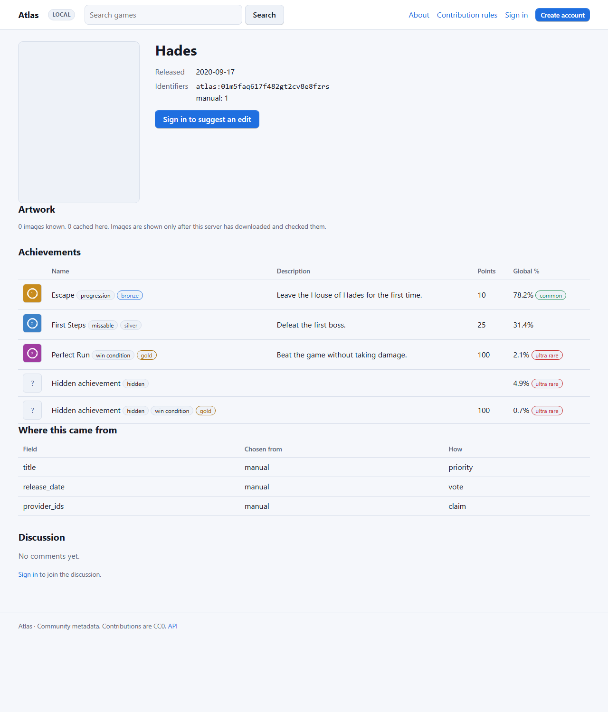
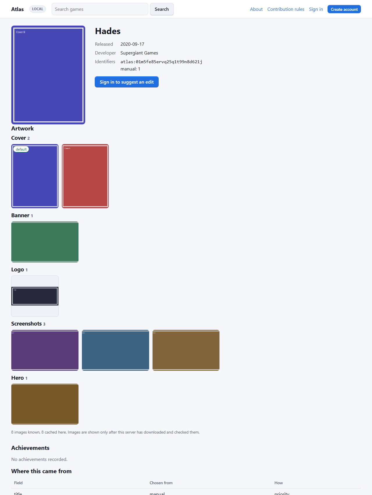

# The Unnamed Tracking App

Atlas works with the [Unnamed Tracking App](https://github.com/obsoletelabs/unnamed_tracking_app_2) in two independent ways. Use either or both.

## Metadata: the Atlas provider plugin

The plugin **`official.metadata-atlas`** adds Atlas as a provider for games, anime, movies and TV shows: typed search, merged metadata, achievements for games, artwork and a health check.

### Install

1. Run an Atlas node ([Quick start](quickstart.md)) and create a token with only the **`read`** scope (**Admin → Tokens**).
2. Get the signed package from the official catalogue. The media-type support described here is introduced in Atlas provider **0.7.0**; development builds from `python tools/build_packages.py` are isolated unsigned previews and require explicit consent.
3. In the app: **Plugin Manager** → install the `.utp` (unsigned previews need explicit consent) and grant the declared permissions.
4. Open the provider's settings and enter **Atlas server URL** (`https://atlas.example.org`, optional path prefix) and **Atlas API token** (write-only, stored encrypted by the app).

### What it does

| Operation | Behaviour |
| --- | --- |
| Search | `GET /api/v2/games?q=…&type=…`; searches the requested type (`game`, `anime`, `movie` or `tv_show`) and returns the Atlas ID plus every linked provider ID (`steam`, `igdb`, `tmdb`…) |
| Metadata | maps Atlas fields into the app's game, anime, movie or TV fields and forwards bounded custom values. A candidate without an Atlas ID is resolved by linked provider IDs or exact title and year, constrained to the same media type; uncertain matches are dropped |
| Achievements | for games, supplies definitions, descriptions, hidden flags, global percentages and cached icons. The app imports definitions without changing player progress, and can resolve Atlas records from linked IDs such as Steam. Non-game records do not request achievements |
| Media | lists only artwork Atlas has downloaded and verified. For anime, movies and TV, key art is exposed as a poster. The app fetches the public `<server>/media/<hash>` links itself |
| Health | checks the configured URL and read token |

The app combines Atlas with its other providers. The user's provider order sets the default winner when two sources give different values; fields that only one source has are retained. Image providers have their own order. Atlas's achievement catalogue is a separate resource, so the app can refresh definitions without replacing game metadata from Steam or another provider.




### Contract tests

`tests/test_tracking_app_contract.py` covers the plugin's read-only token, search variations, lookup by Atlas ID, resolving a candidate that only has other provider IDs, metadata and achievement fields, artwork before and after caching, and tokenless public `/media/<sha256>` downloads. It also covers the incremental change endpoint below, in both its signed and its local mode. An Atlas change that breaks these client requests fails this contract suite.

`tests/test_resolve_contract.py` replays `tests/fixtures/resolve-contract-v1.json`, the `/resolve` cases a client vendors (see below), and checks the database state behind them.

### Resolving ids (`POST /resolve`)

`/resolve` maps what the app holds (provider ids, an Atlas id, a title and year) to a canonical Atlas id. It is read-only. Each result says **why** in `reason`, and how strong the evidence is in `tier`:

| `reason` | `tier` | `canonical_id` | Assign it? | When |
| --- | --- | --- | --- | --- |
| `id` | `id` | the record | yes | an Atlas id you sent (`namespace: "atlas"` or `provider_ids.atlas`) names a live record |
| `redirect` | `id` | the live record | yes, and replace your stored id | that Atlas id was merged; `redirected_from` is the id you sent |
| `crosswalk` | `id` | the record | yes | your provider ids point at exactly one record |
| `conflict` | `id` | `null` | **no** | your ids point at more than one record. `conflict` lists them, `conflict.own` is the record your item's own `namespace`/`external_id` points at, `conflict.review_id` the open curator review if there is one |
| `type_mismatch` | `id` | `null` | **no** | your ids only point at records of another media type |
| `exact` | `strong` | the record | yes | no id matched; the normalized title is equal, the year agrees enough to reach the auto-match threshold, and the next candidate is 0.1 behind |
| `fuzzy` | `strong` | the record | only if you opt in | as `exact` with a near-equal title. Capped at 0.8, so it only appears when an administrator lowers the threshold |
| `ambiguous` | `weak` | `null` | **no** | title candidates exist but cannot be assigned: too weak, too close to each other, or contradicted by an id you hold (see below) |
| `none` | `none` | `null` | no | nothing |

Rules a client can rely on:

* An id-tier answer never depends on the title. A renamed record keeps its id and resolves by its provider ids whatever title you send; the rename itself shows up in `/changes` as a new version.
* A merged Atlas id keeps resolving, through up to 20 merges, with `reason: redirect`. `GET /games/{old id}` returns the live record with `redirected_from` too. Ids are followed by id, never by title.
* Placeholder titles such as `Steam app 12345` or `GOG game 1207658924` are never title evidence. A placeholder record refreshes by its provider id or not at all.
* Equal titles are not proof. Two records may share a title (`Doom`, 1993 and 2016). When you send an id in a namespace (say `steam`) that Atlas does not know, and the best title candidate already has a different id in that namespace, the answer is `ambiguous`, not `exact`.
* `method` is kept for older clients. Since contract C4 it is `none` whenever `canonical_id` is `null`. **Behaviour change:** an id conflict used to return the item's own record with `method: crosswalk`; it now returns `canonical_id: null` and `method: none`, so an older client stops adopting a contested id.
* `matched_keys` lists the ids you sent that Atlas knows and the live record each points at. `release_date` may be `YYYY`, `YYYY-MM` or `YYYY-MM-DD`; only the year is used.

Ingest (`POST /observations`) is unchanged: on an id conflict it still attaches the observation to its own record and opens an `id_conflict` review for a curator.

The fixture `tests/fixtures/resolve-contract-v1.json` holds these cases as data (seed records, requests, expected `reason`, `tier` and record). A client can vendor it with the digest in `resolve-contract-v1.json.sha256`, computed over the file with LF line endings.

### Incremental client updates

Client apps that cache Atlas records can ask which records changed since they last looked. The
route has two modes, chosen with `feed`. Use **`feed=local`**: it is the recommended mode.

```http
GET /api/v2/changes?feed=local&since=9000&epoch=9c41e07a5b2d8f13&limit=100
Authorization: Bearer <read-scope-token>
```

```json
{
  "feed": "local",
  "node_id": "3f2a9c0d1e2b4a55",
  "epoch": "9c41e07a5b2d8f13",
  "head": 9123,
  "next_cursor": 9100,
  "has_more": true,
  "reset": false,
  "results": [
    {"id": "atlas:0123456789abcdefghijklmnop", "version": 14, "merged_into": null, "causes": ["provider"]},
    {"id": "atlas:1123456789abcdefghijklmnop", "version": 5, "merged_into": "atlas:2123456789abcdefghijklmnop", "causes": ["merge"]}
  ]
}
```

| Mode | What it covers |
| --- | --- |
| `feed=local` (recommended) | Every client-visible change on **this** node: entries it signed, entries it applied from an upstream, local edits, provider imports (artwork, achievements, crossplay and other fields from Steam, IGDB and so on), merges and detaches. The cursor is this node's local change log. |
| no `feed`, or `feed=signed` | The signed federation feed, unchanged from earlier releases. It **misses provider imports**, because data that may not be redistributed never enters the signed feed. On a mirror or local node it also needs `node_id=<authority>`. The response says `"feed": "signed"` and `"local_feed": true` (this node also serves the local mode). |

How to poll:

1. **First run.** Call `/changes?feed=local` once and store its `head` as your cursor **together with its `epoch`**, then read the records you need through the usual endpoints (in that order, so nothing that changes in between is missed). The log only holds changes made after this release was installed, so it is not a way to list every record.
2. **Each poll.** Call with `since=<stored cursor>&epoch=<stored epoch>`. Refresh every record in `results` (the record itself, its achievements and its artwork), then store `next_cursor` and `epoch`. Repeat while `has_more` is true. `limit` is 1–500 log rows; a page lists each record once with its **current** version, so a record can show a version newer than the change that put it in the page.
3. **Merges.** A non-null `merged_into` is a redirect: re-point your cached record to the destination, which is in the same page.
4. **Reset.** If `reset` is `true`, `results` is empty and your cursor cannot be continued. This happens when the log was pruned past your cursor (see below), or when it was recreated or rewound (a database restore, a rollback and re-upgrade of this release, a recovered node), which gives it a new `epoch`, or when the cursor came from another node. Store `next_cursor` and the new `epoch` **first**, then re-read every cached record. Re-reading also catches what a rolled-back release changed, since it did not log its changes. Never treat `reset` as "nothing changed".

`causes` lists why the record changed within the page: `feed`, `replicated`, `local`, `provider`, `merge` or `detach`. It is informational; refresh the record whatever it says. `version` only ever increases for a record, so you can skip a refresh when your cached copy already has that version.

The two modes have separate cursors. Do not pass a cursor from one to the other, and do not send `node_id` with `feed=local` (that is a `400`): the local log has no other origin. A cursor also belongs to one node: if you switch to a different Atlas node, start again from step 1.

**Always send `epoch`.** A `since` alone cannot tell a recreated log from progress: after a restore or a rollback the sequence starts again lower, and once new changes push the head past your old cursor a page without `epoch` silently skips everything up to it. Without `epoch` the only stale cursor Atlas can detect is one above the head. `epoch` is not allowed with the signed feed (that is a `400`).

**Retention.** Once a day the node deletes log rows older than `ATLAS_CLIENT_CHANGES_RETAIN_DAYS` (90 by default) that have a newer row for the same record. The newest row of every record is always kept, so a client that has been away for longer still sees every record that changed; its cursor may then be below the oldest kept row, which is answered with `reset`.

**Privacy and licensing.** The local log holds a record id, a version and a cause, never record content. It is served only to this node's own clients with the `read` scope. It is never signed, never sent to followers or relays, and never copied into a [recovery candidate](recovery.md). Provider data a client fetches after a change is subject to the same rules as before.

The route requires the `read` scope. It returns IDs and versions only; clients fetch changed records, achievements and artwork through their usual endpoints.


### Limits to know

* The app downloads artwork itself and refuses private addresses, so artwork needs a publicly reachable Atlas. Metadata works on a LAN.
* Atlas serves achievement definitions but never player progress; unlock state belongs to each app user.
* The plugin sends no personal data: only titles, years and provider IDs.

### Verified host workflow

The [release drill](release-verification.md) installs the unchanged signed `.utp` through the
real Plugin Manager, approves its exact declared permissions, starts the runtime worker and
uses ordinary host accounts. It checks secret redaction/system-configuration denial, search,
canonical/store identifiers, metadata enrichment, achievement definitions, per-user search-session ownership, game creation,
the metadata-refresh endpoint, manually protected fields and an unreachable Atlas.
Host, runtime and Atlas communicate over real HTTP; gateways and provider replies are not
mocked. The container runtime uses its documented `NONBUBBLE_ENV` development fallback, so
this is functional acceptance, not verification of production sandbox isolation. The existing
refresh response labels a focused local record **Library** even when Atlas supplied fields.

The drill exercises the signed package with a real local stack. The incremental client route is
covered by Atlas contract tests and does not change the plugin's request flow.

## Signing in to the Tracking App with Atlas

**This needs no plugin.** The app has first-class OpenID Connect support (**Settings → Administration → Single sign-on**), and Atlas is a standard provider. A plugin can't add login methods (plugins have no login hook), and none is needed.

It has been verified with the app's own client stack: the same Authlib registration the app uses (`src/core/oidc.py`) completes a login against a live Atlas, receiving the ID token and claims (`tools/compat/tracking_app_oidc.py`).

### Step by step

**On Atlas**

1. Turn on **Act as a sign-in provider (OIDC)** in **Admin → Settings → Federation**. `ATLAS_PUBLIC_URL` must be the public `https://` address.
2. **Admin → Sign-in sharing → Register application:**
   * *Name:* `Unnamed Tracking App`
   * *Redirect addresses:* the exact callback the app shows, `https://<your-app>/api/auth/oidc/callback/<slug>` (choose the slug in step 3; e.g. `atlas`).
   * *Token signature:* **RS256**
   * *Require PKCE:* **un-tick**. The app's client authenticates with its secret and does not send PKCE.
   * Copy the **client id** and **secret**.

**In the Tracking App** (**Settings → Administration → Single sign-on → Add provider**)

| Field | Value |
| --- | --- |
| Provider name / slug | `Atlas` / `atlas` |
| Issuer / discovery URL | `https://atlas.example.org` |
| Client ID / secret | from Atlas |
| Scopes | `openid profile email` |
| Groups claim / admin group | leave empty (Atlas sends no groups) |
| User matching | **Username** if the same people use the same names, otherwise **Email** |
| Allow new users | your choice |
| Require verified email | **On** if you only want addresses people have confirmed (Atlas sets `email_verified` accordingly) |
| Login button | text such as “Continue with Atlas” |

### Things to expect

* The app requires an **email claim**: an Atlas user without an email address cannot sign in. Authority nodes require one anyway.
* Users see Atlas's consent screen once per sign-in, then land in the app.
* There is no group or admin mapping. Make administrators in the app.
* Signing out of the app does not sign out of Atlas, and vice versa.

If something fails, see [Sign-in sharing → Troubleshooting](sso.md#troubleshooting).

### Want this to be one click?

A preset “Add Atlas” template in the app's SSO settings (pre-filling scopes and matching) would be a small change **in the app itself**, not in a plugin. It is not done; it would be a pull request to the app repository.
