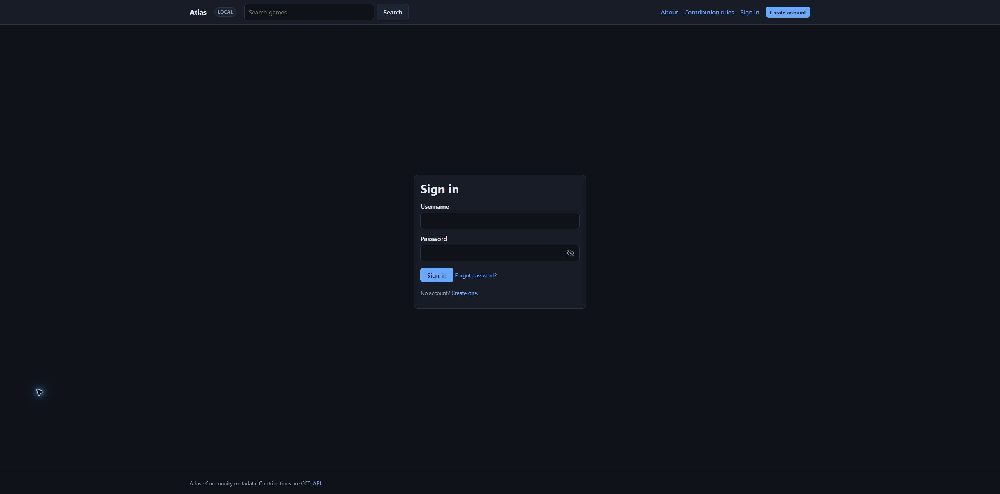

# Using the site

## Browsing

Anyone can search and read games, anime, movies and TV shows, along with their artwork, discussions and public profiles. The home page links to each media type, and its browse page lists the latest records. A record page shows merged facts, identifiers (with links where they exist), a **Where this came from** table, and recent changes. Games also show achievements and store links.

The home page keeps search at the center of the experience. Its horizontal media links open the latest games, anime, movies or TV shows; a search from the home page can find records across types.

A phone-sized screen works the same way; the site follows your system's light or dark setting.

### Dates

Every date on the site goes through one formatter, so it looks the same on every page. The default is
**day/month/year** (`17/09/2020`). In **Settings → Preferences** you can choose `17 September 2020`,
`09/17/2020` (month/day/year) or `2020-09-17` (ISO); times follow the same choice (month/day/year uses a
12-hour clock unless you pick 24 hours). Recent events also say how long ago they were ("5 min ago"), and
hovering a date shows it in full. Without an account the choice is kept in a cookie (`atlas_date`) and becomes
your account's preference the first time you sign in, unless the account already has one.

A browser that reports US English **and** a US time zone is asked once whether it wants month/day/year. Choosing
either answer stores it; the × closes the question in that browser only. Nothing is shown without JavaScript.

A date that is known only to the month or the year is never shown as a day: `September 2020` or `2020`.

### Release dates

A record shows only as much of its first release as is known: a year (`2011`), a month (`April 2011`) or a
day, in the date format you chose in your settings. It is never padded to a 1 January. Below the facts, a
**Release dates** table lists up to five dated releases by platform, region, edition and type (full
release, early access, beta, re-release, port, demo).

Search can narrow and order by first release: **Released from** and **to** take a year, a month or a day,
and a record matches only when its whole release is inside the range, so a game known only as "2011"
appears for 2011 but not for April 2011. **Oldest release first** puts a year-only date before the months
and days of that year; records without a date come last.

When you edit a record, the release date field takes the date in your format (the placeholder shows it, for
example `dd/mm/yyyy, mm/yyyy or yyyy`), ISO (`2020-09-17`, `2020-09`, `2020`) or a month name (`17 Sep 2020`,
`September 2020`); enter only what is known. When a numeric date such as `03/04/2021` can be read two ways and
you have not chosen a format, the form asks which one you meant before anything is saved. Five rows take the
per-platform dates. Empty rows are ignored; an invalid row (an impossible
day such as 2023-02-29, an unknown region, two rows for the same platform, region, edition and type) is
reported and your input is kept. A less precise date never replaces a more precise one it agrees with:
"2011" next to a source's "2011-04-19" leaves the day.

### Related records and editions

A **Related** section on a record page links the records it belongs to (the game a DLC is for, the original
of a port or remake, its series and the collections or bundles that include it), the records that belong to it,
and its editions. See [Relationships and editions](relations.md).

## Creating an account

**Create account** needs a username (3–32 letters, digits, `-`, `_`) and a password of at least the node's minimum length (10 by default). An email address is optional on a private node; **central (authority) nodes require one** and ask you to confirm it before you can contribute. We send a link; opening it shows a button to confirm (so mail scanners cannot confirm for you).

*Forgot your password?* on the sign-in page emails a link that works for one hour and once. It signs you out everywhere. The same message is shown whether or not the account exists.

Sign-in and account-recovery forms are centered in the space between the site header and footer. On the sign-in page, use the eye button to show or hide the password while you type.

## Suggesting changes

## Browsing artwork

The **Artwork** section of a record page shows every image this server has downloaded and checked, grouped by type (cover, banner, hero, logo, icon, screenshots, poster) with the default first. Click an image to open it in a viewer on the same page: you see its source, status, size and votes; the arrow keys (or the Previous / Next buttons) move between images of the same type, **Esc** closes it and returns focus to where you were. Without JavaScript each image opens on its own page with the same details. Images that are assigned but not downloaded yet are listed below as text and are never loaded.

Signed-in members with a confirmed email can **upvote or downvote** an image and **propose it as the default** for its type. Votes are opinions shown next to the image: they never reorder or replace anything by themselves. A default change is a proposal that goes through the same review as other artwork changes (applied at once for reviewers and trusted members, reviewable and revertable, no reputation reward). The default is local to the server you are using and is not published to other nodes.

On a record page choose **Suggest an edit**. You can change core fields and any **custom fields** the administrators defined, and add a source or note for reviewers. The home page's **Add a record** form lets you choose a media type before entering details. Signed-in members can suggest artwork for every type; **Edit achievements** and store linking are available on games. See [Achievements](achievements.md).

What happens next depends on your reputation:

| You are | Your change… |
| --- | --- |
| new | waits in the review queue (a limited number per day) |
| trusted (reputation ≥ the node's threshold, 50 by default) | applies at once, and can still be reverted; self-applied changes earn no reputation |
| a reviewer | applies at once |

Reviewers see exactly what changes (old and new). You can **withdraw** a pending proposal and **discuss** it with reviewers on its page (only you and reviewers can see that thread).

### Reputation

* A reviewer **approves** your proposal: **+5** (edit), **+10** (new record), **+3** (artwork), **+5** (achievements).
* **Rejected**: −2. **Reverted** later: −10 and the points it earned.
* A moderator **hides** one of your comments: −3.

Reputation unlocks: immediate application (default 50) and review rights (default 500; admins can also promote people). Administrators can change every number.

## Lists, follows and your inbox

* **Lists:** *Favourites* and *Wishlist* exist for everyone; make more. Lists are private unless you make them public. They hold games only (completion lives in your tracker).
* **Follow** a game or a person; changes show up in your **Inbox** (repeats within an hour fold into one entry). In **Profile settings** you can opt in to emails for them (confirmed addresses only).
* **Comments** are plain text, up to 2000 characters, on games and (privately) on proposals. `@name` notifies someone. You can edit for 15 minutes, delete your own, and report others'. Three independent reports hide a comment until a moderator decides.

## Your profile and your data

`/u/<you>` shows your reputation, badges and accepted contributions. In **Profile settings** you can hide it, write a short bio, **download everything we hold about you** (JSON) and **delete your account**. Deleting removes your profile, lists, follows, notifications and tokens and signs you out everywhere; your accepted contributions are public domain (CC0) and stay, detached from your name.

## Personal API tokens

**My account → API tokens** creates *read-only* tokens for your own scripts. They cannot write (contribute through the site so changes are reviewed) and stop working if your account is suspended.

## Signing in with another node

If your node's administrator enabled sign-in sharing, the sign-in page shows buttons such as *Sign in with Central*. See [Sign-in sharing](sso.md).
