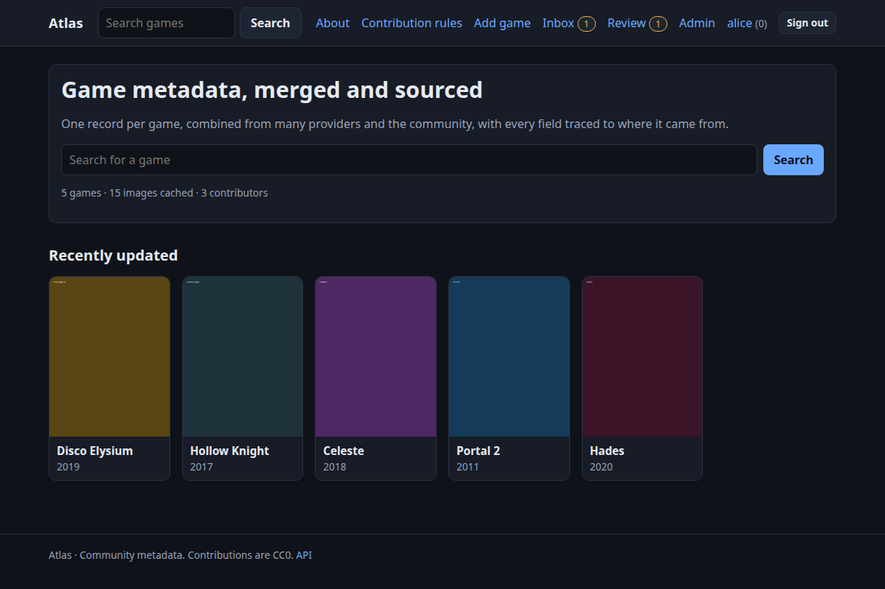
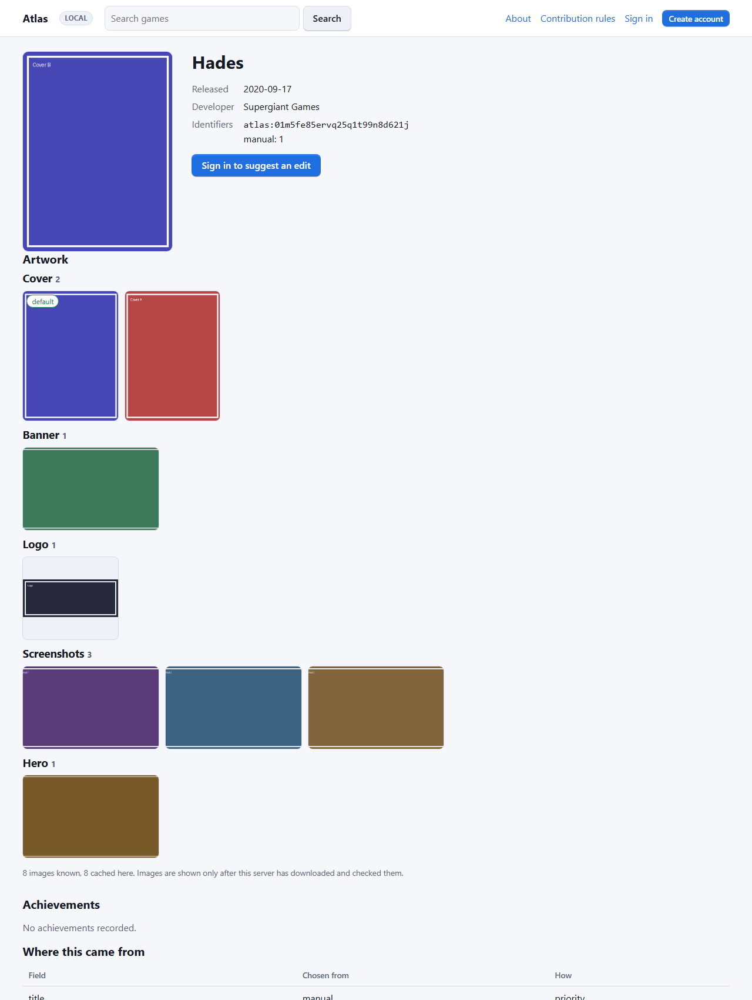
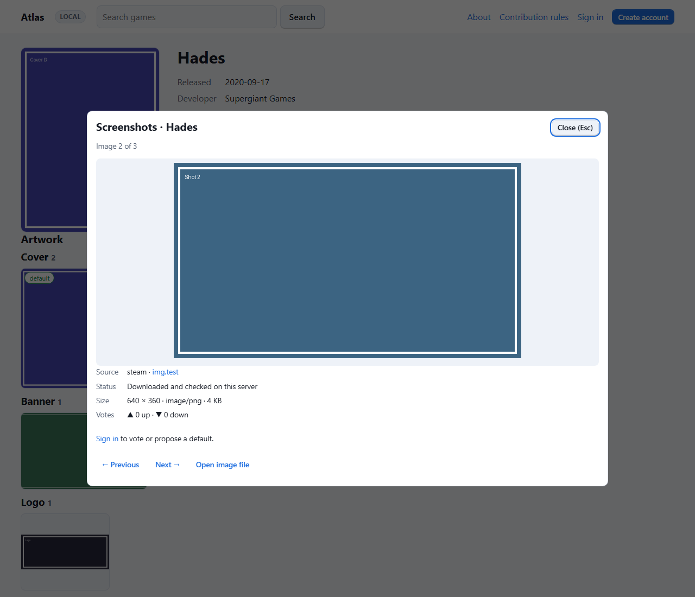
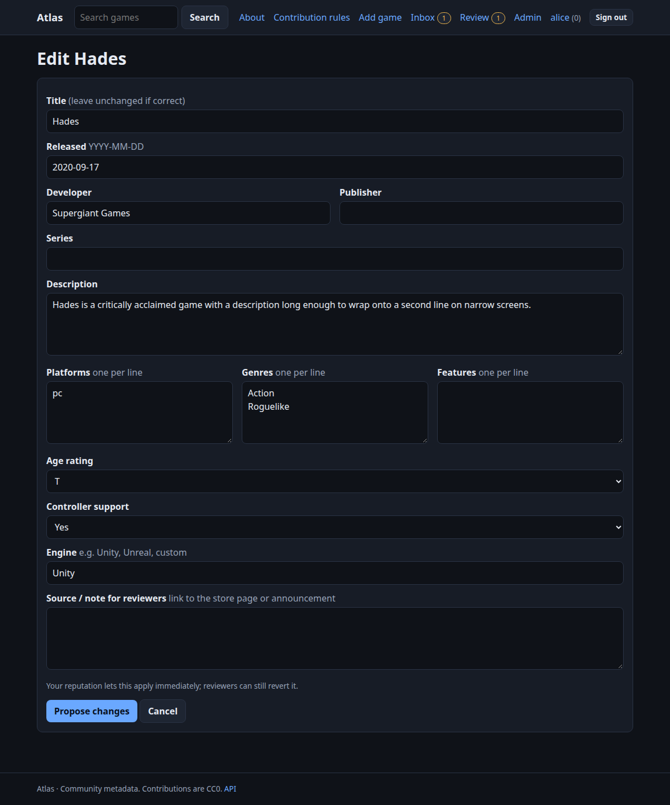

# Using the site

## Browsing

Anyone can search and read: games, artwork, achievements, discussions and public profiles. Each game page shows the merged facts, identifiers (with links where they exist), achievements, a **Where this came from** table, and recent changes.

A phone-sized screen works the same way; the site follows your system's light or dark setting.

## Creating an account

**Create account** needs a username (3–32 letters, digits, `-`, `_`) and a password of at least the node's minimum length (10 by default). An email address is optional on a private node; **central (authority) nodes require one** and ask you to confirm it before you can contribute. We send a link; opening it shows a button to confirm (so mail scanners cannot confirm for you).

*Forgot your password?* on the sign-in page emails a link that works for one hour and once. It signs you out everywhere. The same message is shown whether or not the account exists.

## Suggesting changes

## Browsing artwork

The **Artwork** section of a game page shows every image this server has downloaded and checked, grouped by type (cover, banner, hero, logo, icon, screenshots, poster) with the default first. Click an image to open it in a viewer on the same page: you see its source, status, size and votes; the arrow keys (or the Previous / Next buttons) move between images of the same type, **Esc** closes it and returns focus to where you were. Without JavaScript each image opens on its own page with the same details. Images that are assigned but not downloaded yet are listed below as text and are never loaded.

Signed-in members with a confirmed email can **upvote or downvote** an image and **propose it as the default** for its type. Votes are opinions shown next to the image: they never reorder or replace anything by themselves. A default change is a proposal that goes through the same review as other artwork changes (applied at once for reviewers and trusted members, reviewable and revertable, no reputation reward). The default is local to the server you are using and is not published to other nodes.

On a game page choose **Suggest an edit**. You can change core fields and any **custom fields** the administrators defined, and add a source or note for reviewers (link the store page or announcement: it speeds review). *Add game* proposes a new record; *Suggest artwork* and *Add achievements* are on the game page.

What happens next depends on your reputation:

| You are | Your change… |
| --- | --- |
| new | waits in the review queue (a limited number per day) |
| trusted (reputation ≥ the node's threshold, 50 by default) | applies at once, and can still be reverted; self-applied changes earn no reputation |
| a reviewer | applies at once |

Reviewers see exactly what changes (old and new). You can **withdraw** a pending proposal and **discuss** it with reviewers on its page (only you and reviewers can see that thread).

### Reputation

* A reviewer **approves** your proposal: **+5** (edit), **+10** (new game), **+3** (artwork), **+5** (achievements).
* **Rejected**: −2. **Reverted** later: −10 and the points it earned.
* A moderator **hides** one of your comments: −3.

Reputation unlocks: immediate application (default 50) and review rights (default 500; admins can also promote people). Administrators can change every number.

## Lists, follows and your inbox

* **Lists:** *Favourites* and *Wishlist* exist for everyone; make more. Lists are private unless you make them public. They hold games only (completion lives in your tracker).
* **Follow** a game or a person; changes show up in your **Inbox** (repeats within an hour fold into one entry). In **Profile settings** you can opt in to emails for them (confirmed addresses only).
* **Comments** are plain text, up to 2000 characters, on games and (privately) on proposals. `@name` notifies someone. You can edit for 15 minutes, delete your own, and report others'. Three independent reports hide a comment until a moderator decides.

## Your profile and your data

`/u/<you>` shows your reputation, badges and accepted contributions. In **Profile settings** you can hide it, write a short bio, **download everything we hold about you** (JSON) and **delete your account**. Deleting removes your profile, lists, follows, notifications and tokens and signs you out everywhere; your accepted contributions are public domain (CC0) and stay, detached from your name.

## Personal API tokens

**My account → API tokens** creates *read-only* tokens for your own scripts. They cannot write (contribute through the site so changes are reviewed) and stop working if your account is suspended.

## Signing in with another node

If your node's administrator enabled sign-in sharing, the sign-in page shows buttons such as *Sign in with Central*. See [Sign-in sharing](sso.md).
